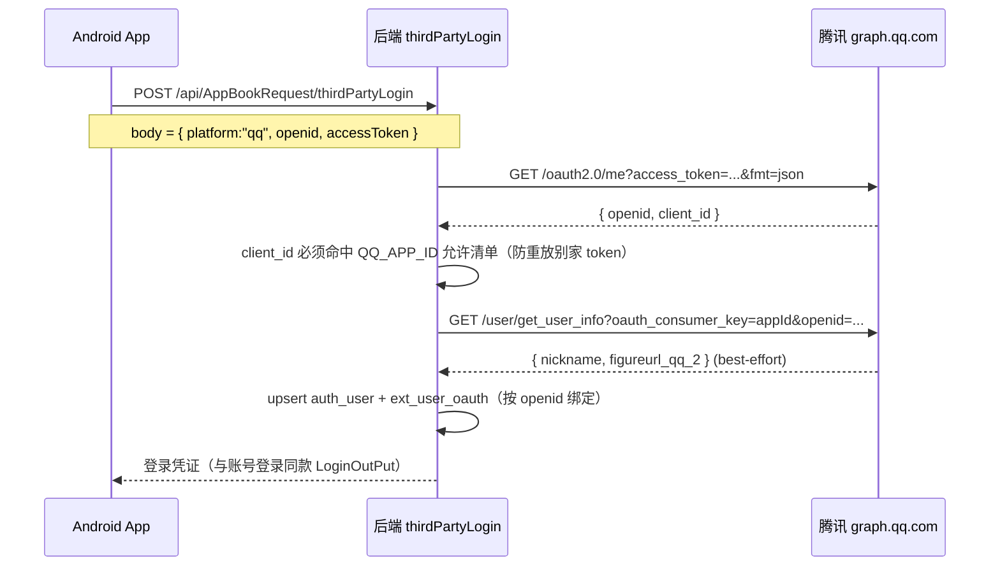

# QQ 第三方登录：后端校验配置与上线清单

> 配套文档：
> - 设计决策 `docs/novel-cms/adr/0050-app-login-methods-config.md`
> - Android 端接入 `AndroidProject-old/docs/adr/0013-qq-third-party-login.md`
> - 后端实现 `src/server/tcm/app-third-party.ts` + `src/pages/api/AppBookRequest/thirdPartyLogin.ts`
>
> 本文只回答一件事：**后端 `verifyQqToken`（oauth2.0/me + openid）这条链路，需要你设置和管理什么**。
> 结论先行：token 本身不需要你管理（无缓存、无刷新），真正要管的是三类配置——Worker 环境变量、D1 登录开关、以及上线动作。

---

## 1. 链路回顾：为什么你"不需要管理 token"

每次登录的时序：



要点（来自 `app-third-party.ts`，非记忆）：

- **没有 token 缓存，也没有刷新逻辑**。客户端每次登录都带**当次全新的 `accessToken`**，后端 `verifyQqToken` 现验现用。
- `oauth2.0/me` 只传 `access_token`，回 `openid` + `client_id`；后端再用 `get_user_info`（带 `oauth_consumer_key=appId` + `openid`）拉昵称/头像。
- `get_user_info` 是 **best-effort**：失败只降级为空串（昵称/头像为空），**不阻断登录**（`fetchQqUserInfo` 全程 try/catch 降级）。
- 后端**绝不信任客户端自报的 openid**——永远以 `oauth2.0/me` 回的权威 `openid` 为准（`appThirdPartyLogin` 里 `trustedOpenid` 覆盖传入值）。

> 所以你**不需要**做：token 缓存、token 刷新、openid→账号的手动绑定（自动 `INSERT OR IGNORE` + 回查兜底）。

---

## 2. 需要你管理的三类配置

### A. Worker 环境变量（fail-closed 闸门）

后端在 `appThirdPartyLogin` 开头有硬门：

```ts
if (!runtimeEnv.QQ_APP_ID || !runtimeEnv.QQ_APP_SECRET) return "QQ 校验失败";
```

也就是说，**这两个缺任一，端点会一路 `fail-closed` 报「QQ 校验失败」**，连腾讯都不会去调。

| 变量 | 取值 | 作用 | 缺省后果 |
|---|---|---|---|
| `QQ_APP_ID` | `1906152348,1906152522,1906151545`（正式,测试,预览，**逗号分隔允许清单**） | `verifyQqToken` 校验腾讯回的 `client_id` 是否命中本应用某变体（防重放别家 token） | 空 → 「QQ 校验失败」 |
| `QQ_APP_SECRET` | 真实 AppKey（**任一变体**即可，见下注） | **仅作存在性闸门**，代码要求非空才放行 | 空 → 「QQ 校验失败」 |
| `QQ_OAUTH_DEV_MOCK` | **留空**（别设） | 仅本机/局域网 + 设 `"1"` 时跳过腾讯校验做本地联调 | 生产不声明即 `undefined`，旁路在线上不存在 |

**关于 `QQ_APP_SECRET` 的坑（只在线上暴露、本地测不出）**：

- `manage dev` 渲染 per-instance `wrangler.jsonc` 时**不会**自动注入这两个键；根 `wrangler.jsonc` 里 `QQ_APP_ID/SECRET` 只是空串占位。
- 因此**生产必须靠远程 secret 提供**，否则线上 `env.QQ_APP_ID` 恒为 `undefined`。
- `manage-cli/lib/config.ts:598-599` 已把 `QQ_APP_ID` / `QQ_APP_SECRET` 列入 `requiredSecrets()`，部署时会提示你设远程 secret。
- `QQ_OAUTH_DEV_MOCK` **刻意不**出现在 `requiredSecrets()`——生产不登记即 `undefined`，本地模拟旁路在线上开不出来（安全性不依赖人工约定）。

> 注：`QQ_APP_SECRET` 是单值，但三个 AppID 各有各的 AppKey。因为腾讯 `oauth2.0/me` 与 `get_user_info` **实际都没用到 secret**（只用 `access_token` / `oauth_consumer_key=appId`），所以只填任一变体的真实 AppKey 即可，allow-list（`QQ_APP_ID`）才是真正起校验作用的那一个。

### B. D1 登录方式开关（后台「登录管理」）

`appThirdPartyLogin` 在读密钥后、验 token 前，先读 `settings` 表 `category=app_login_methods`：

```ts
const loginMethods = await readLoginMethodsConfigCached(...);
if (!loginMethods.loginEnabled) return "登录功能开发中,敬请期待";
if (!loginMethods.qqEnabled) return "该登录方式已停用";
```

两道硬门必须开：

| 开关 | 含义 | 关闭后果 |
|---|---|---|
| `loginEnabled` | 总闸 | 返「登录功能开发中,敬请期待」 |
| `qqEnabled` | QQ 方式闸 | 返「该登录方式已停用」 |

读写链路（见 `src/server/app/login/config.ts`）：

- 读：`readLoginMethodsConfigCached` → 走 `caches.default` 缓存（约 1 天 TTL），命中 0 D1 行读。
- 写：`saveLoginMethodsConfig` 写 `settings` 表后**清缓存条目**；后台「登录管理」页面的保存就走这条。
- **改后若立即可见性没刷新** → 因为 `caches.default` 仍返回旧副本。要么等 TTL 过期，要么通过后台页面「保存」触发 `saveLoginMethodsConfig` 清缓存（不要手动去删 cache blob 目录，除非确认是 dev 调试）。

> 之前 ADR-0050 里我们把 `qqEnabled` 的 `reserved` 改为 `false`，就是为了让这个开关在后台页面能正常翻、角标消失（不再显示「预留·未接通」）。

### C. 不需要你管的（确认清单）

- token 缓存/刷新：客户端每次带新 `accessToken`，后端现验现用。
- openid→账号绑定：自动 upsert 到 `ext_user_oauth` + `auth_user`，并发首登用 `INSERT OR IGNORE` + 回查兜底（见 `createQqUser`：email/username 双重唯一键回查，避免幽灵绑定）。
- 限流：端点已接入 `enforceAuthEndpointThrottle`（路径感知，含本端点），同一 IP 60s 内 >5 次返 429，无需你配。
- `unionid`：腾讯侧「未获取」也**不影响登录**——本设计三个 AppID 有意账号隔离（debug/正式互不相通），登录只用 `openid`，后端 `verifyQqToken` 也只走 `oauth2.0/me` + `openid`。**不需要申请 unionid。**

---

## 3. 本地 dev 怎么配（已做，记录备查）

- 写 `.microfeed/instances/ctwh-881019-xyz/.dev.vars`（**不是** 根目录 `.dev.vars`，后者对本项目无效）：
  ```
  QQ_APP_ID="1906152348,1906152522,1906151545"
  QQ_APP_SECRET="OiZEhw0vd7ORGrEN"
  ```
- 启动必须用 `node --import tsx manage-cli/index.ts dev --instance ctwh-881019-xyz`（直启 `astro dev` 会读错 D1/迁移/`.dev.vars`，导致 500）。

---

## 4. 生产上线清单（照着勾）

| # | 动作 | 命令 / 位置 | 验证 |
|---|---|---|---|
| 1 | 设远程 secret：`QQ_APP_ID` | `wrangler secret put QQ_APP_ID` = `1906152348,1906152522,1906151545` | 部署后 `env.QQ_APP_ID` 非空 |
| 2 | 设远程 secret：`QQ_APP_SECRET` | `wrangler secret put QQ_APP_SECRET` = 真实 AppKey（任一变体） | 部署后 `env.QQ_APP_SECRET` 非空 |
| 3 | 后台「登录管理」开 `loginEnabled` = true | D1 `settings` 表 `app_login_methods` | 不再返「登录功能开发中」 |
| 4 | 后台「登录管理」开 `qqEnabled` = true | 同上 | App 登录页出现 QQ 入口、可点 |
| 5 | **不要**设 `QQ_OAUTH_DEV_MOCK` | 生产不声明即 `undefined` | dev-mock 旁路在线上不存在 |
| 6 | 端到端联调 | App 点 QQ → 授权 → 回调 → `thirdPartyLogin` 校验 → 落首页 | 见 §5 判读 |

> 第 1–2 步之所以必须走 `wrangler secret put` 而不是写进 `wrangler.jsonc` 的 `vars`：与 `RESEND_API_KEY` 同路——`manage-cli` 渲染的 per-instance `wrangler.jsonc` 模板 `vars` 里没有 QQ 键；若同时用 `vars` 声明又设远程 secret，会触发 `--strict` 部署的「同名冲突」中止。secret 是生产真实值的唯一正确来源。

---

## 5. 联调结果判读（端到端）

| 现象 | 含义 | 下一步 |
|---|---|---|
| 进授权页 → 回调 App → 后台落首页 | 全链路通 | 完成 |
| 仍然 `110401 请求的应用不存在` | 腾讯侧包名/签名/同步问题（非审核问题） | 回 QQ 互联后台核对包名+签名 MD5；新应用信息同步有延迟（官方口径最慢 30 分钟） |
| 变成 `110406 应用未通过审核` | 该 AppID 仍未过审，且当前登录的 QQ 号不是开发者本人 | 用注册该应用的开发者号登录，或等审核通过（审核期仅开发者可测） |
| 变成 `100044` | 签名校验失败 | 核对 jks MD5 = `35a518f825601fa64574f5531cb66013` |
| 后端返「QQ 校验失败」 | `QQ_APP_ID`/`QQ_APP_SECRET` 未配或为空 | 检查远程 secret 是否生效 |
| 后端返「该登录方式已停用」 | `qqEnabled=false` | 后台开 `qqEnabled`；注意 caches.default 缓存延迟 |
| 后端返「登录功能开发中」 | `loginEnabled=false` | 后台开 `loginEnabled` |

---

## 6. 平台侧状态（已结案 / 长期口径）

- **已结案（2026-10-30）**：三个 AppID —— `1906152348`（release）/ `1906152522`（debug）/ `1906151545`（preview）—— **全部审核通过**。
  debug 变体真机实测 QQ 登录成功，服务端落库 `qq_39746869556B3DEAF1163DDCD5A12B9D@oauth.local`（`auth_user.name = xjx-bbx`）、
  `ext_user_oauth.openid = 39746869556B3DEAF1163DDCD5A12B9D`。此前那次 `110401` 确认为平台同步延迟，现已消失。
- **长期口径**：`110401` = 请求的应用不存在（同步/包名/签名问题），**与审核状态无关**；`110406` 才是「未过审被挡」；
  `100044` = 签名校验失败。审核期开发者本人可正常 SSO 调试（腾讯 wiki 长期口径），但不能开放给其他 QQ 号。
