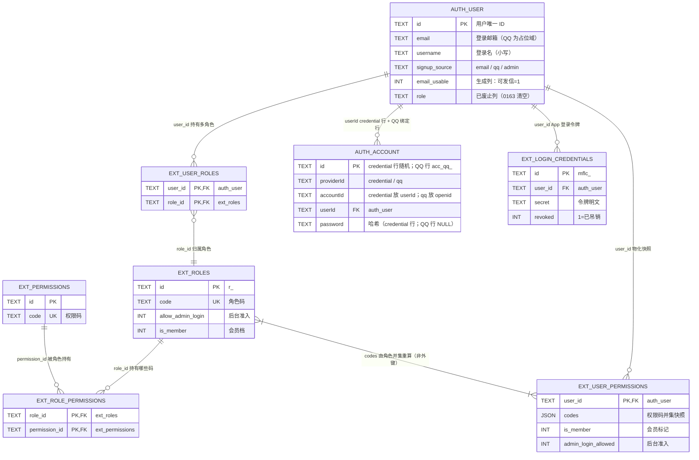

# 12 用户体系与变更

> **用途**：理解用户体系全貌、查阅字段、了解功能演进（谁在什么时候改了什么），以及修改时的规范位置。
> **触发词**：用户、角色、权限、RBAC、username、signup_source、注册来源、用户管理、auth_user、ext_roles、ext_user_roles、ext_permission_nodes、权限快照、login_credential、登录凭证、封禁、角色守卫、权限树。
> **加载时机**：要改用户/角色/权限相关功能、查用户表字段、或理解用户体系历史演进时读取本册。

## 1. 总览与来源

- **认证引擎**：Better Auth（`emailAndPassword` + `username` / `passkey` / `oauthProvider` 三个插件），配置在 `src/server/auth/better-auth.ts`。admin 插件已移除（ADR-0054），`/api/auth/admin/*` 第二授权面不复存在。
- **登录身份**：邮箱**或**用户名。`username` 插件已启用（0039），用户名 3–32 位、只含 `[a-zA-Z0-9_.]`，存小写。第三方登录（本期仅 QQ）走自研 `appThirdPartyLogin`（ADR-0013），**不使用** Better Auth 的 `socialProviders`，因此不写 `auth_account`。
- **账号附属属性**：`signup_source`（三值 `email` / `qq` / `admin`，建号时写定，此后不改）、`email_usable`（生成列，占位邮箱判 0）、`username` / `displayUsername`。
- **RBAC 自研**（ADR-0052 判定引擎保持自研）：角色目录 `ext_roles` / 权限目录 `ext_permissions` / 角色授权 `ext_role_permissions` / 账号角色 `ext_user_roles` / 权限树 `ext_permission_nodes`，外加按账号物化的**权限快照** `ext_user_permissions`（ADR-0053）。详见 §5。
- **迁移来源**：完整清单与逐条变更见 §7。本册涉及的迁移都在 `migrations/`，编号 0002–0165。
- **本版本无 2FA / 备份码表。**

## 2. 账号与会话表

### 2.1 `auth_user` — 用户主体（0002 建表，0039/0157/0158/0159 增列）

| 字段 | 类型 | 说明 |
| --- | --- | --- |
| `id` | TEXT (PK) | 用户唯一标识 |
| `name` | TEXT NOT NULL | 显示名称 |
| `email` | TEXT NOT NULL UNIQUE | 登录邮箱。QQ 与用户名建号写占位邮箱 `*@users.microfeed.local` |
| `emailVerified` | INTEGER NOT NULL | 邮箱是否已验证（0/1） |
| `image` | TEXT | 头像 URL |
| `createdAt` | DATE NOT NULL | 创建时间 |
| `updatedAt` | DATE NOT NULL | 更新时间 |
| `role` | TEXT | **已废止列**（ADR-0054）。曾是有损角色镜像：持 `super_admin` 记 `admin`，其余记 `user`，只服务 Better Auth admin 插件。插件已移除，此列停写停读，存量值由 `0163` 清为 NULL；列本身保留是为了避开重建表与 18 张表的外键改动 |
| `banned` | INTEGER | 是否封禁（0/1）。三个后台写操作改为自研 UPDATE 后，应用层读写都归自己（ADR-0054）；登录闸门只读它 |
| `banReason` | TEXT | 封禁原因 |
| `banExpires` | DATE | 封禁到期时间（NULL=永久）。**当前判定不读它**，只看 `banned` |
| `username` | TEXT | 登录名之一（0039）。`UNIQUE` 索引，NULL 表示未设置 |
| `displayUsername` | TEXT | 用户名的展示原样（保留输入大小写） |
| `signup_source` | TEXT NOT NULL DEFAULT `'email'` | 注册来源，三值见 §6.2。建号后任何操作都不得修改 |
| `email_usable` | INTEGER 生成列（VIRTUAL） | `lower(email)` 以 `@oauth.local` 或 `@users.microfeed.local` 结尾记 0，否则 1。用来筛「能发信的账号」 |

> 索引：`auth_user_username`（`username` 唯一）、`ix_auth_user_email_lower`（`lower(email)` 表达式索引，按邮箱查账号的兜底路径靠它，0158）、`ix_auth_user_email_usable`（`email_usable`）。

### 2.2 `auth_session` — 登录会话

| 字段 | 类型 | 说明 |
| --- | --- | --- |
| `id` | TEXT (PK) | 会话 ID |
| `expiresAt` | DATE | 过期时间 |
| `token` | TEXT (UNIQUE) | 会话令牌 |
| `createdAt` / `updatedAt` | DATE | 时间戳 |
| `ipAddress` | TEXT | 登录 IP |
| `userAgent` | TEXT | 客户端 UA |
| `userId` | TEXT (FK→auth_user) | 所属用户 |
| `impersonatedBy` | TEXT | 被哪个管理员模拟登录（冒充审计） |

### 2.3 `auth_account` — 凭证关联

| 字段 | 类型 | 说明 |
| --- | --- | --- |
| `id` | TEXT (PK) | 关联记录 ID |
| `accountId` | TEXT | 提供方侧账户标识 |
| `providerId` | TEXT | 提供方。本仓只有 `credential`（QQ 不走这张表） |
| `userId` | TEXT (FK→auth_user) | 所属用户 |
| `accessToken` / `refreshToken` / `idToken` | TEXT | OAuth 令牌字段（本仓未使用） |
| `accessTokenExpiresAt` / `refreshTokenExpiresAt` | DATE | 令牌过期时间（本仓未使用） |
| `scope` | TEXT | 授权范围（空格分隔） |
| `password` | TEXT | 密码哈希（`providerId = 'credential'`） |
| `createdAt` / `updatedAt` | DATE | 时间戳 |

### 2.4 `auth_verification` — 验证令牌

| 字段 | 类型 | 说明 |
| --- | --- | --- |
| `id` | TEXT (PK) | 令牌 ID |
| `identifier` | TEXT | 标识（通常为邮箱） |
| `value` | TEXT | 验证码 / 令牌值 |
| `expiresAt` | DATE | 过期时间 |
| `createdAt` / `updatedAt` | DATE | 时间戳 |

### 2.5 `auth_rate_limit` — 认证限流

| 字段 | 类型 | 说明 |
| --- | --- | --- |
| `id` | TEXT (PK) | 记录 ID |
| `key` | TEXT (UNIQUE) | 限流键（动作 + 标识） |
| `count` | INTEGER | 当前计数 |
| `lastRequest` | BIGINT | 上次请求时间戳（毫秒） |

### 2.6 `auth_password_setup` — 初始 / 重置密码令牌（仅 owner）

| 字段 | 类型 | 说明 |
| --- | --- | --- |
| `id` | TEXT (PK，固定 `'owner'`) | 只有一条 |
| `purpose` | TEXT | `initial` 初始设置 / `reset` 重置 |
| `email` | TEXT | 管理员邮箱 |
| `userId` | TEXT | 关联用户（重置后回填） |
| `tokenHash` | TEXT (UNIQUE) | 令牌哈希 |
| `createdAt` / `expiresAt` | DATE | 时间戳 |

### 2.7 `microfeed_installation` — 实例身份

| 字段 | 类型 | 说明 |
| --- | --- | --- |
| `id` | TEXT (PK，`CHECK id = 'installation'`) | 固定主键 |
| `instanceId` | TEXT (UNIQUE) | 实例唯一 ID（首次验证前由 Worker 生成） |
| `createdAt` | DATE | 创建时间 |

### 2.8 `ext_email_otp` — 邮箱验证码（0153）

| 字段 | 类型 | 说明 |
| --- | --- | --- |
| `id` | TEXT (PK) | 记录 ID |
| `email` | TEXT NOT NULL | 收件邮箱 |
| `purpose` | TEXT NOT NULL | 用途隔离：`register` / `reset` / `forget` |
| `code_hash` | TEXT NOT NULL | 验证码摘要（不存明文） |
| `expires_at_ms` | INTEGER NOT NULL | 过期时刻（毫秒） |
| `attempts` | INTEGER NOT NULL DEFAULT 0 | 已尝试次数 |
| `last_sent_at_ms` | INTEGER NOT NULL | 最近发信时刻（重发节流） |
| `created_at_ms` | INTEGER NOT NULL | 创建时刻 |

> 索引：`ext_email_otp_email_purpose_idx`、`ext_email_otp_expires_idx`（0156 补，清理语句按 `expires_at_ms` 过滤）。

### 2.9 `ext_rate_limit` — 限流与一次性台账（0166，ADR-0056）

| 字段 | 类型 | 说明 |
| --- | --- | --- |
| `kind` | TEXT NOT NULL（PK 之一） | 分类：`auth-throttle` / `app-quota` / `bind-quota` / `login-failure` / `email-otp-ip` / `replay-nonce` / `captcha-nonce` |
| `key` | TEXT NOT NULL（PK 之一） | 分类内的键：IP + 路径、凭证 id、nonce、reqNo 摘要、userId… |
| `count` | INTEGER NOT NULL DEFAULT 1 | 窗口内已用次数；一次性台账恒为 1 |
| `expires_at_ms` | INTEGER NOT NULL | 计数器 = 窗口终点；台账 = 保留终点 |

> 主键 `(kind, key)`，索引 `ext_rate_limit_expires_idx`（`expires_at_ms`，清理与取最早过期行共用）。分类隔离由 schema 保证，不靠键名前缀。
>
> 两类语义共用一张表的依据只有一条：**一行在 `expires_at_ms` 之后无意义**。计数器在窗口翻转时原地把 `count` 重置为 1；台账插入即消费，`INSERT OR IGNORE` 的 `changes` 判首次。因此清理只有一条 `DELETE ... WHERE expires_at_ms < ?`，搭在写入路径上按 1% 采样。
>
> 分类参数唯一定义在 `src/server/rate-limit/kinds.ts`；窗口算术在 `window.ts`，插入即消费在 `once.ts`，清理在 `prune.ts`。本表取代 0030 / 0037 / 0059 / 0147 / 0156 五张表（0166 已 DROP）。
>
> App 内容端点的消费链路不变：Cache 标记先拦（被拒流量零 D1）→ 配额行在鉴权批次取回 → 版本门通过后单条 UPSERT。

### 2.10 ~~`ext_user_oauth`~~ — 第三方登录绑定（0155 建，0165 退役）

**已退役（ADR-0055，迁移 `0165_schema_unify_third_party_identity`）**：QQ 绑定改由 `auth_account` 的 `providerId = 'qq'` 行承载——`accountId` 列放 openid，`userId` 挂账号（FK CASCADE），token / password 列留 NULL，行 id 为确定性值 `'acc_qq_' || openid`。幂等闸门建立在 `UNIQUE INDEX auth_account_provider_account (providerId, accountId)` 上。历史迁移 0155 只追加不改；旧快照恢复时 0164 的重放会完成回填与删表。登录建号与后续复用的判定流程见 §6.4。

### 2.11 `ext_user_security` — 账号安全标记（0028）

| 字段 | 类型 | 说明 |
| --- | --- | --- |
| `user_id` | TEXT (PK, FK→auth_user, CASCADE) | 账号 |
| `must_change_password` | BOOLEAN NOT NULL DEFAULT 0 | 强制改密标记。**当前无人写入为 1**（0042 清空过，本部署不强制首次改密），守卫仍保留 428 分支备用 |

### 2.12 `ext_user_devices` — 设备登记与吊销（0029）

| 字段 | 类型 | 说明 |
| --- | --- | --- |
| `user_id` | TEXT NOT NULL (PK 之一, FK→auth_user, CASCADE) | 账号 |
| `device_id` | TEXT NOT NULL (PK 之一) | 设备标识，取自 `X-Device-Id` 头（≤64 位 `[A-Za-z0-9_-]`） |
| `last_seen_at` | TIMESTAMP NOT NULL | 最近一次出现时刻，每次鉴权请求覆盖（每设备永远只有一行） |
| `status` | TEXT NOT NULL DEFAULT `'active'` | `'active'` 正常 / `'revoked'` 已吊销 |
| `created_at` | TIMESTAMP | 首次登记时刻 |

> 主键 `(user_id, device_id)`；索引 `status`、`user_id`，0137 补 `(device_id, last_seen_at DESC)`。心跳 UPSERT 只动 `last_seen_at`，**绝不解除吊销**（`registerUserDevice`，5 分钟写节流）；吊销判定必须先于心跳执行，否则会被洗掉。「最近三个月哪几天出现过」回答不了——历史被压扁成一行，按天留痕是 §2.15 的职责。

### 2.13 ~~`ext_replay_nonces`~~ — 防重放 nonce（0030 建，0166 退役）

**已退役（ADR-0056）**：改由 `ext_rate_limit` 的 `kind = 'replay-nonce'` 行承载——`key` 是 nonce，`expires_at_ms` 是 `X-Timestamp + 5 分钟`。仅 App **非安全方法**带 `X-Timestamp` / `X-Nonce` 时写入（GET/HEAD 幂等不记，省一次行写）；`INSERT OR IGNORE` 的 `changes = 0` 即重放。浏览器流量从不写这张表。

### 2.14 ~~`ext_auth_throttle`~~ — 登录端点限流（0059 建，0166 退役）

**已退役（ADR-0056）**：这张表原本同时住着三种窗口、靠键前缀区分，合并后各自是独立分类——`kind = 'auth-throttle'`（5 次 / 60s，登录端点按 IP + 路径）、`'bind-quota'`（10 次 / 24h，补邮箱发码按账号）、`'email-otp-ip'`（20 次 / 60s，验证码发码按 IP）。

> 由来：better-auth 的 customRules 只盖 `/sign-in/email`（5/60s），用户名登录被 100/60s 的宽松默认覆盖，留下暴力破解缺口。限流执行点在 `/api/auth` 单喉道（`src/pages/api/auth/[...all].ts`），不碰 `better-auth.ts` 红线文件。

### 2.15 `ext_app_login_log` — App 登录时间日志（0084，0085 增列）

| 字段 | 类型 | 说明 |
| --- | --- | --- |
| `id` | TEXT (PK) | deviceId 的**保长度编码**（deviceId 允许 `-` 与 `_`，朴素规范化会把 `a-b` 与 `a_b` 折成同 id 撞主键，见 `loginLogId()`） |
| `user_id` | TEXT (FK→auth_user, CASCADE，**可空**) | 账号；未登录启动时为 NULL |
| `device_id` | TEXT NOT NULL | 设备 |
| `log_date` | TEXT NOT NULL | UTC 自然日（D1 拿不到设备本地日历日；后台区间筛选一律用 `login_at` 比较，不用 `log_date` 拼接） |
| `login_at` | TIMESTAMP NOT NULL | 最近一次登录时刻（0085 起每次覆盖） |
| `login_count` | INTEGER NOT NULL DEFAULT 1 | 当日累计（0085 增列：冲突时 +1 并覆盖 `login_at`） |
| `created_at` | TIMESTAMP | 首次记录 |

> 去重真正生效在 `UNIQUE(device_id, log_date)`，**不是**主键。写入点是匿名的 `GET /api/app/version`（0085 起）——覆盖联网启动（含未登录），完全离线的启动无痕迹。与 §2.12 的分工：那张表答「这设备现在活跃吗」，这张答「最近三个月哪几天启动过」。

### 2.16 ~~`ext_app_request_quota`~~ — App 内容端点按凭证限流（0147 建，0166 退役）

**已退役（ADR-0056）**：改由 `ext_rate_limit` 的 `kind = 'app-quota'` 行承载——`key` 是 `credential_id`，`expires_at_ms` 是窗口终点。每凭证固定窗口 10,000 次 / 24h，参数在 `src/server/rate-limit/kinds.ts`；窗口翻转原地重置，行数 = 活跃凭证数。

### 2.17 `ext_admin_typeahead` — 后台 typeahead FTS5 派生表（无迁移）

| 字段 | 类型 | 说明 |
| --- | --- | --- |
| `haystack` | FTS5 索引列 | `标题 + 空格 + lower(id)` 逐字切成空格分隔 token（unicode61），查询用短语 `MATCH '"黄 芪"'` 表达子串语义 |
| `content_id` | UNINDEXED | 对应 `items.id` |

> **不是普通表**：FTS5 虚拟表，由 `src/shared/ItemSearchSql.ts` 在应用层 `CREATE VIRTUAL TABLE` + `items` 三个触发器同步，**不在 `migrations/` 里**（本地门禁库与快照都排除它，`buildRestoreSql()` 重建时须先 DROP 再回填）。0151 注释明确保留：webhooks 事件浏览器的条目候选在用。站点全文搜索表族（`site_search_*`）已于 0151 整体退役（ADR-0051）。

## 3. API 密钥与 OAuth

### 3.1 `api_keys` — 签名调用密钥（0006，0018 / 0033 / 0148 演进）

| 字段 | 类型 | 说明 |
| --- | --- | --- |
| `id` | TEXT (PK) | 密钥 ID |
| `name` | TEXT NOT NULL COLLATE NOCASE UNIQUE | 密钥名称（不区分大小写） |
| `secret_hash` | TEXT | 密钥明文的摘要（0148 起不再存明文） |
| `api_key_hint` | TEXT | 明文尾部片段，供列表辨认 |
| `scopes` | TEXT NOT NULL DEFAULT `'content:read content:write'` | 作用域（空格分隔，0018） |
| `created_at_ms` / `updated_at_ms` | INTEGER NOT NULL | 时间戳 |

### 3.2 `ext_api_key_owners` — 密钥归属（0032）

| 字段 | 类型 | 说明 |
| --- | --- | --- |
| `api_key_id` | TEXT (PK, FK→api_keys) | 密钥 |
| `user_id` | TEXT NOT NULL (FK→auth_user) | 归属账号，签名调用按它解析权限 |
| `created_at_ms` | INTEGER NOT NULL | 创建时刻 |

### 3.3 `ext_api_access_log` — 签名调用审计（0034，0038 扩宽）

| 字段 | 类型 | 说明 |
| --- | --- | --- |
| `id` | TEXT (PK) | 记录 ID |
| `api_key_id` | TEXT（可空） | 签名密钥调用时填 |
| `credential_id` | TEXT（可空） | 登录凭证 bearer 调用时填（0038） |
| `user_id` | TEXT NOT NULL | 调用者账号 |
| `method` / `path` | TEXT NOT NULL | 请求方法与路径 |
| `permission_code` | TEXT NOT NULL | 本次判定用的权限码 |
| `granted` | INTEGER NOT NULL | 是否放行（0/1） |
| `status` | INTEGER NOT NULL | 响应状态码 |
| `created_at_ms` | INTEGER NOT NULL | 时刻 |

> `api_key_id` 与 `credential_id` 恰好一个非空，用于区分两条 bearer 通道。

### 3.4 `oauth_client` — OAuth / OIDC 客户端（0007）

字段：`id`、`clientId`（UNIQUE）、`clientSecret`、`disabled`、`skipConsent`、`enableEndSession`、`subjectType`、`scopes`、`userId`（FK→auth_user）、`createdAt`、`updatedAt`、`name`、`uri`、`icon`、`contacts`、`tos`、`policy`、`softwareId`、`softwareVersion`、`softwareStatement`、`redirectUris`（NOT NULL）、`postLogoutRedirectUris`、`tokenEndpointAuthMethod`、`grantTypes`、`responseTypes`、`public`、`type`、`requirePKCE`、`referenceId`、`metadata`。内置客户端 `microfeed-cli`。

### 3.5 `oauth_refresh_token` / `oauth_access_token` / `oauth_consent`

三张令牌与同意表，字段沿用 Better Auth oauthProvider 插件定义（`token`、`clientId`、`sessionId`、`userId`、`referenceId`、`expiresAt`、`scopes`、`revoked` / `authTime` 等）。它们都是会话态，不随快照迁移（见 `manage-cli/lib/snapshot.ts` 的 `ephemeral`）。

## 4. 通行密钥与连接

### 4.1 `passkey` — 通行密钥（0008）

字段：`id`、`name`、`publicKey`（NOT NULL，COSE）、`userId`（FK→auth_user）、`credentialID`（NOT NULL）、`counter`、`deviceType`、`backedUp`、`transports`、`createdAt`、`aaguid`。

### 4.2 `oauth_connection` — 用户已连接的 OAuth 应用

字段：`id`、`clientId`（FK→oauth_client）、`userId`（FK→auth_user）、`name`（NOT NULL）、`createdAt`、`updatedAt`、`lastUsedAt`。

## 5. 角色与权限（RBAC）体系

自研判定引擎，**角色是唯一的授权载体**。六张表分三层：目录（`ext_roles` / `ext_permissions`）、关系（`ext_role_permissions` / `ext_user_roles`）、物化（`ext_user_permissions`），另有权限树 `ext_permission_nodes` 与菜单 `ext_menu`。

### 5.1 表结构

| 表 | 主键 | 字段 | 作用 |
| --- | --- | --- | --- |
| `ext_roles` | `id`（形如 `r_<code>`） | `code` UNIQUE、`name`、`allow_admin_login`（默认 1）、`is_member`（默认 0，0144）、`created_at`、`updated_at` | 角色目录 |
| `ext_permissions` | `id`（由 `permissionId(code)` 推导） | `code` UNIQUE、`name` | 权限码目录 |
| `ext_role_permissions` | `(role_id, permission_id)` | 外键均 CASCADE | 角色持有哪些码 |
| `ext_user_roles` | `(user_id, role_id)` | 外键均 CASCADE | 账号持有哪些角色 |
| `ext_user_permissions` | `user_id` | `codes`（JSON 数组）、`is_member`、`admin_login_allowed`、`updated_at` | **权限快照**（0162，ADR-0053） |
| `ext_permission_nodes` | `id`（`pn_*`） | `code` UNIQUE、`kind`（`group`/`page`/`code`）、`parent_code`、`permission_code`、`audience`（`desktop`/`app`）、`path`、`entry_code`、`name_zh`/`name_en`、`icon`、`i18n_key`、`is_visible`、`sort`、`source`、`created_at_ms` | 权限树（ADR-0038 自持，ADR-0039 按终端分区） |
| `ext_menu` | `id` | `code` UNIQUE、`parent_code`、`path`、`i18n_key`、`icon`、`permission_code`、`sort`、`is_visible`、`name_zh`/`name_en` | 后台菜单行，可见性靠 `permission_code` 直列判定 |
| `ext_rbac_audit` | `id` | `actor_user_id`、`actor_label`、`action`、`target`、`detail`、`before_detail`、`created_at_ms` | 角色与授权改动的审计 |

`ext_menu_permissions`（0040 建、0052 重建并种子）**已删除（0164）**：0127 权限树自持（ADR-0038）、0145 起菜单可见性走 `ext_menu.permission_code` 直列后，本表零读零写，0164 物理删除，索引随表消失。

### 5.2 判定顺序

`src/server/rbac/guard.ts` 的顺序即定论（顺序改动等于权限漏洞）：

1. 无已登录用户 → **401**
2. `auth_user.banned = 1` → **401**
3. 设备被吊销 → **401**
4. 所持角色的 `allow_admin_login` 并为 0 → **403**（会话有效，只是不许进后台）
5. `must_change_password = 1` 且不在豁免名单 → **428**
6. 持通配 `*` → 放行（短路，不展开目录）
7. 权限码在集合内 → 放行
8. 其余 → **403**

**没有** `auth_user.role = 'admin'` 的遗留旁路（0053 删除），也没有第二套授权面：admin 插件挂出的 15 条 `/api/auth/admin/*` 端点已随插件删除（ADR-0054），`auth_user.role` 不参与任何一步判定。

### 5.3 读取路径

后台每个请求读一行快照（`src/server/rbac/snapshot.ts` 的 `readSnapshotGate`）：一条点查把权限码、会员标记、后台准入、封禁位、待改密一次取回。App 侧两条读路径同样读快照（`readSnapshotAccess`）：`cachedUserAccess` 的缓存未命中回源、`resolveAppPermissionSet` 的功能开关判定。

`resolveUserAccess` / `resolveUserPermissions` / `userMayEnterAdmin` 三个按真源现算的读法保留在 `resolve.ts`，用途是比对与测试，**运行时不再调用**。

### 5.4 快照的写入约定

快照是仓库里唯一的物化镜像。**改真源的写入点必须在同一批 `db.batch` 里重算**，共 9 处：`replaceRolePermissions`、`replaceUserRoles`、`setRbacRoleAdminLogin`、`setRbacRoleMember`、后台建号、`bootstrap.ts`、`password-setup.ts`、`seedRbac`、删账号（显式删快照行）。重算语句只能来自 `snapshot.ts` 的两个构造器；`tests/unit/permission-snapshot.test.ts` 沿 TypeScript 语法树逐函数检查，漏调即报函数名。

`banned` 不进快照：读路径已在同一条语句里 `FROM auth_user u LEFT JOIN` 顺带取回，物化既不减往返也不减行数，只多一处需要同步的写点。

漂移用 `scripts/check-permission-snapshot.ts` 查：报「缺快照行 / 多余快照行 / 权限码不等 / 两个布尔不等」四类，退出码 0 一致、1 有差异。

### 5.5 角色与权限码

- **种子角色三个**（`src/server/rbac/seed.ts` 的 `RBAC_ROLES`）：`super_admin`（只持 `*` 一个授权）、`editor`、`readonly`（**name 是「默认编辑」，权限与 `editor` 相同**；code 保留 `readonly` 是因为 `r_readonly` 被多处引用）。新账号默认拿 `readonly`（`DEFAULT_USER_ROLE`）。
- **运营自建角色**在后台「角色管理」里增删；本机实例另有 `manage`（15 个授权）与 `member`（0 个授权，`allow_admin_login = 0`）两个。
- **本机实例规模**（2026-11-01）：9 个账号 / 10 条账号角色 / 65 个权限码 / 权限树 104 个节点（PC：6 组 + 30 页 + 53 码；App：1 组 + 3 页 + 11 码）/ 菜单 36 行。
- **权限码三镜像**：`src/shared/Constants.ts`、`src/server/rbac/seed.ts`、迁移（0031 起逐批追加）。三者必须同批改，否则出现「码在目录里、树上没有」或反向漂移。

### 5.6 关联总览（ER 图）

`auth_user` 与 RBAC 多角色桥接、`auth_account`（credential 行 + QQ 绑定行）、`ext_login_credentials` App 令牌之间的完整关联。Better Auth 核心表（含外键）另见同目录 `user-system-er.svg`（§8），本图补的是那张 SVG **不含**的 `ext_*` 链路。



> **关键事实**：多角色以「`auth_user` → `ext_user_roles`（桥接）→ `ext_roles` → `ext_role_permissions` → `ext_permissions`」实现并集授权，运行时读 `ext_user_permissions` 快照（§5.3/§5.4）。`auth_account` 一表承载两类身份行：`credential`（口令哈希）与 `qq`（openid 绑定，ADR-0055，唯一索引 `(providerId, accountId)` 把幂等闸门落在表自身）；App 登录令牌走 `ext_login_credentials`（§2.3/§2.10/§6.1/§6.4）。

## 6. 登录凭证与注册来源

### 6.1 `ext_login_credentials` — 个人登录凭证（0036）

给某个账号签发长期令牌（`mflc_…`），脚本或第三方以该账号身份登录，免交互式鉴权。

| 字段 | 类型 | 说明 |
| --- | --- | --- |
| `id` | TEXT (PK) | 凭证 ID |
| `user_id` | TEXT NOT NULL (FK→auth_user) | 所属账号 |
| `name` | TEXT NOT NULL | 名称 / 备注 |
| `secret` | TEXT NOT NULL | 令牌明文，供有库权限的运维重新分发 |
| `secret_hash` | TEXT NOT NULL | 令牌 SHA-256 摘要，鉴权按它查 |
| `created_at_ms` | INTEGER NOT NULL | 创建时刻 |
| `expires_at_ms` | INTEGER | 过期时刻；NULL = 永不过期 |
| `revoked` | INTEGER NOT NULL DEFAULT 0 | 1 = 已吊销（行保留以便追溯） |
| `last_used_at_ms` | INTEGER | 最近使用时刻 |

> 索引：`ext_login_credentials_secret_hash`、`ext_login_credentials_user`。猜令牌的节流计数在 `ext_rate_limit` 的 `kind = 'login-failure'`（10 次 / 60s，登录成功即清空）。

### 6.2 `signup_source` — 注册来源（三值，无后台开关）

- **列**：`auth_user.signup_source`，`NOT NULL DEFAULT 'email'`（0157）。
- **三值固定**，代码侧是联合类型 `SignupSource = "email" | "qq" | "admin"`（`src/shared/Rbac.ts`）：
  - `email` 邮件注册。better-auth `signUpEmail` 内部写库，只能吃列的 DEFAULT；
  - `qq` QQ 首登建号，`src/server/tcm/app-third-party.ts` 的 `createQqUser` 显式写（首登建号 / 复用判定见 §6.4）；
  - `admin` 管理侧任意入口（`bootstrap.ts` / `password-setup.ts` / `rbac-handlers.ts`）。
- **建号后任何操作都不得修改**（ADR-0014 I12）：补邮箱、绑定 QQ、解绑、提权都不动这一列。
- 不能改成按 QQ 绑定行（`auth_account.providerId = 'qq'`，ADR-0055）是否存在派生——绑定那一刻值会翻转，注册来源就丢了。也不能只做二值：`@users.microfeed.local` 那类用户名账号既不是邮件注册，也无法发信。
- **消费方**：后台用户页左树按它分组（`src/components/admin/rbac/UsersApp/index.tsx`），`RbacUser.signupSource` 直接读这一列。
- **没有**「注册来源管理」配置项：`settings` 表里没有 `signup_sources` 分类，也没有 `ajax/signup-sources` 端点。要加档位只能改代码 + 迁移。

### 6.3 占位邮箱

用户名建号与 QQ 首登建号都没有真实邮箱，统一写 `*@users.microfeed.local`（常量 `PLACEHOLDER_EMAIL_DOMAIN`，定义在 `src/shared/AdminCredentials.ts`，0159 统一过域）。历史遗留域 `@oauth.local` 只剩存量行，`email_usable` 生成列把两者都判为 0。

### 6.4 QQ 第三方登录流程（首登建号 / 后续登录复用）

入口 `appThirdPartyLogin`（`src/server/tcm/app-third-party.ts`）。本期仅 QQ（`platform = 'qq'`），**不**接入 Better Auth `socialProviders`；自 ADR-0055（0165）起 openid 绑定落在 `auth_account` 的 `providerId = 'qq'` 行（§2.3/§2.10），登录令牌走 `ext_login_credentials`。流程顺序即安全模型，**不可调换**：

1. **业务闸门**：`readLoginMethodsConfigCached` + `enforceLoginMethodsGates(loginMethods, loginMethods.qqEnabled)`；`QQ_APP_ID` / `QQ_APP_SECRET` 缺失一律 fail-closed 拒绝。`QQ_OAUTH_DEV_MOCK = '1'` 且请求 host 为本机 / 局域网时跳过腾讯调用，但业务闸门仍参与（生产域名命中不了白名单，线上误置也开不出旁路）。
2. **身份校验**：`verifyQqToken(accessToken, QQ_APP_ID)` 调 `https://graph.qq.com/oauth2.0/me`，取回权威 `openid` 与 `client_id`；`client_id` 必须命中 `QQ_APP_ID` 逗号分隔允许清单（防重放别家 token）。校验失败统一对外回「QQ 校验失败」，具体原因只写服务端日志。
3. **解析账号（复用闸门）**：`findUserIdByOpenid(openid)` 查 `auth_account` 的 qq 绑定行；**查到则跳过建号，直接走复用**。
   ```sql
   SELECT "userId" FROM "auth_account"
   WHERE "providerId" = 'qq' AND "accountId" = ? LIMIT 1
   ```
4. **凭据签发**：`ensureAppLoginCredential(user)` 复用该用户未撤销的 App 登录凭证（名称 `app-login:<username>`，落 `ext_login_credentials`）；无存活凭据才新建（受每用户 5 把上限约束，触顶返回 `null` → 登录失败文案）。
5. **组包返回**：`thirdPartyLoginPayload` 返回 `Token` / `Account = qq_<openid>` / 昵称 / 头像。

#### 6.4.1 首登建号（幂等）

`createQqUser`（仅第 3 步返回 null 时调用）：

- 写 `auth_user`：占位邮箱 `qq_<openid>@users.microfeed.local`、用户名 `qq_<openid小写>`、`signup_source = 'qq'`、`image`（QQ 头像）、`emailVerified = 1`（经由 `authUserInsertSql({ orIgnore: true, signupSource: 'qq', withImage: true, withUsername: true })`）。
- **`INSERT OR IGNORE` + 回查**防并发首登 / 同 openid 换大小写导致的 UNIQUE 冲突（否则未捕获 500）。`changes = 0` 时按 `email OR username` 回查；两条唯一键都查不到才抛错——绝不把 openid 绑到没插成功的 id。
- **防顶号**：回查命中的行必须 `email` 与 `username` **双对得上**（小写比较），否则抛错；防止占位邮箱被抢占后把受害者 openid 签进别人账号。
- 建号后 `bindOpenid`：经 `account-insert.ts` 的 `qqBindingAccountStatement` 写 `auth_account` 绑定行——`INSERT OR IGNORE`，行 id `'acc_qq_' || openid`，幂等闸门由 0165 的 `UNIQUE INDEX auth_account_provider_account (providerId, accountId)` 承担。

#### 6.4.2 后续登录复用（不建号、复用凭据）

第二次及以后登录：第 3 步 `findUserIdByOpenid` 命中既有 `(providerId, accountId)` 唯一索引行（FK 级联到 `auth_user`，删用户才清），`userId` 直接取到，`createQqUser` 整段被 `if (!userId)` 跳过——**不插 `auth_user`、不写新绑定行**。

- **凭据复用**：`ensureAppLoginCredential` 先 `listLoginCredentialsForUser` 再 `.find(r => !r.revoked && r.name === 'app-login:<username>')`，未撤销即**原样返回同一条 `secret`**（token 不变）；只有「无存活凭据」时才 `createLoginCredential` 新建。
- **资料刷新**：`refreshProfile` 仅在 `isQqShellEmail(email)`（仍是占位邮箱）时 best-effort 覆盖 `name` / `image`（`COALESCE(NULLIF(?, ''), 原值)`），不建号；用户绑定真实邮箱后该分支不再覆盖其自改资料。

#### 6.4.3 边界：何时会重新建号

仅 `findUserIdByOpenid` 返回 null 时回退建号：

- 该 openid 的 `auth_account` qq 绑定行被显式删除（如解绑）；
- 用户账号被删（外键级联清掉绑定行）。

正常第二次、第三次登录均稳定命中既有绑定；`INSERT OR IGNORE` 只是首登并发竞争的安全网，不是第 N 次登录的路径。

### 6.5 用户体系关联与登录优化方向

基于对真实表结构与代码路径（`app-third-party.ts` / `rbac/resolve.ts` / `rbac/snapshot.ts`）的分析，列出可优化点与各自的**现状 / 取舍 / 触发条件**。凡涉及迁移的改动须遵守 §7「只追加迁移」与 §8 修改指引。

1. **废弃列治理（`auth_user.role`）**
   - 现状：`role` 列已由 `0163` 清为 NULL，停写停读，仅因删列需重建被 18 张表引用的 `auth_user` 而保留为死列（§2.1）。
   - 取舍：D1 不支持在线 `DROP COLUMN`，保留死列是成本最低的现状方案；但 `emailVerified` 对 QQ 占位账号被硬写成 1、不能当发信判据，脏语义仍残留。
   - 触发条件：大版本重建 `auth_user` 时一并 `DROP COLUMN role`；或把「QQ 占位账号恒为 1」的语义收口到 `email_usable` 生成列（§2.1），让 `emailVerified` 不再承担发信判据。

2. **QQ 首登回查简化（`createQqUser`）——已由 ADR-0055 部分收敛**
   - 现状：幂等闸门已换到 `auth_account` 的 `(providerId, accountId)` 唯一索引（0165），绑定查重不再依赖 `ext_user_oauth`；`createQqUser` 内部的「INSERT OR IGNORE + email/username 双键回查 + 防顶号」分支仍在（§6.4.1）——它防的是 `auth_user` 自身两条 UNIQUE（占位邮箱 / 用户名）与真人撞名，这套判据与绑定表无关，合并消不掉。
   - 取舍：绑定唯一性归表约束、账号唯一性归回查分支，两层各管各的；再往下简化只能动 `auth_user` 的占位键派生规则，收益小风险大。
   - 触发条件：审计发现防顶号分支难维护时再评估。

3. **两套身份抽象收敛——已实施（ADR-0055）**
   - 现状：QQ 绑定已迁入 `auth_account(providerId='qq')`，`ext_user_oauth` 整表退役（0165）；身份抽象只剩 `auth_account` + `ext_login_credentials` 两张。
   - 取舍：存储统一、流程自持——未启用 `socialProviders`，腾讯校验链路与 App 令牌模型都不动，服务端仍不持久化 QQ token。
   - 触发条件：若未来接入 better-auth `socialProviders` 全家桶，需接受 token 持久化并触碰红线文件 `better-auth.ts`，属另一次决策。

4. **`ext_user_oauth` 索引补充——随退役作废**
   - 现状：原「缺 `(user_id, provider)` 反向组合索引」的问题随 0165 删表消失；`auth_account` 已有 `userId` 单列索引（0002）覆盖「列出某账号全部绑定」，按 openid 查绑定走新的 `(providerId, accountId)` 唯一索引。
   - 触发条件：无。若新增按平台枚举全部绑定的后台查询，再按该查询形状补索引。

5. **服务端资料同步能力缺口**
   - 现状：QQ `accessToken` 不持久化，无法服务端静默续期或主动拉昵称/头像；`refreshProfile` 只在占位邮箱时 best-effort 覆盖（§6.4.2）。
   - 取舍：刻意取舍——Android 端不持久化 token，服务端无 token 自然 renew 不了；换得零 token 泄露面。ADR-0055 合并后 `auth_account` 的 token 列现成且留 NULL，存储位不再需要额外设计。
   - 触发条件：若产品要「登录后服务端主动同步资料 / 静默续期」，向 qq 绑定行写入 token 列即可，随之评估续期与加密策略。

6. **权限解析：实时 JOIN vs 快照**
   - 现状：`resolveUserAccess()` 实时 JOIN 全走覆盖索引无表扫描，但返回行数 = 角色数 × 权限数，角色膨胀会增长；`ADR-0053` 已引入 `ext_user_permissions` 物化快照，`resolveRbacContext` 读快照（§5.3 / §5.4）。
   - 取舍：实时真源读法 `resolveUserAccess` / `resolveUserPermissions` / `userMayEnterAdmin` 仅保留给比对与测试，**运行时不应再调用**，否则两套判据漂移。
   - 触发条件：若发现运行时仍有调用实时读法的路径、或快照与真源出现分歧，先固化「运行时统一读快照」这一单一入口（§8 已强调），再排查漂移来源。

7. **权限模型语义（并集限制）**
   - 现状：多角色为**并集**（任一允许即允许，`*` 通配全开），不支持「拒绝 / 角色优先级 / 互斥」（§5.2 第 6–8 步）。
   - 取舍：并集模型简单、无负向权限歧义；但表达不了「某角色禁止某操作」「角色等级压制」等需求。
   - 触发条件：若业务出现负向权限或角色等级诉求，需扩展模型（新增 `deny` 表或角色优先级列），并同步 §5.4 的 9 个快照重算点与 §8 修改指引。

## 7. 用户功能演进与变更记录（重点）

按迁移时间线记录「谁在什么时候改了什么、为什么」——新增字段 / 表一律**只追加迁移**（`migrations/NNNN_<type>_<desc>.sql`），不改历史。0108 及以前的文件名已冻结（`scripts/frozen-migration-names.txt`），wrangler 以文件名记账。

### 7.1 账号与认证

| 迁移 | 变更 | 影响 |
| --- | --- | --- |
| `0002_better_auth` | Better Auth 核心五表：`auth_user` / `auth_session` / `auth_account` / `auth_verification` / `auth_rate_limit` | 用户体系地基 |
| `0003_admin_password_setup` | `auth_password_setup` 初始 / 重置密码令牌（仅 owner 一条） | 首管理员引导 |
| `0004_installation_identity` | `microfeed_installation` 实例身份 | 遥测 / 跨实例区分 |
| `0008_account_security` | `passkey` 通行密钥 | WebAuthn 登录 |
| `0039_auth_user_username` | `auth_user` 增 `username` / `displayUsername`，启用 better-auth `username` 插件 | 账号可用用户名登录 |
| `0042_clear_must_change_password` | 清空 `ext_user_security.must_change_password` | 本部署不强制首次改密（守卫 428 分支留作备用） |
| `0153_schema_ext_email_otp` | `ext_email_otp` 邮箱验证码（`purpose` 隔离 register / reset / forget） | 邮箱 + 验证码注册与找回 |
| `0155_schema_ext_user_oauth` | `ext_user_oauth` 第三方 openid → 账号绑定 | QQ 登录 |
| `0156_schema_captcha_nonce` | `ext_captcha_nonce` 一次性记账 + 补 `ext_email_otp` 过期索引 | 挡住同一张图形码反复提交 |
| `0157_schema_auth_user_attrs` | `auth_user` 增 `signup_source`（NOT NULL DEFAULT `'email'`）与生成列 `email_usable` | 用户页分组 + 占位邮箱判定 |
| `0158_schema_auth_user_email_lower` | `lower(email)` 表达式索引 | 按邮箱查账号的兜底路径不再全表扫描 |
| `0159_data_auth_user_unify_placeholder_email` | 占位邮箱域从 `@oauth.local` + `@users.microfeed.local` 收敛为一个 | 判定只写一处 |
| `0162_schema_ext_user_permissions` | `ext_user_permissions` 权限快照物化（ADR-0053） | 判定从四跳 JOIN 降为一条点查 |
| `0163_data_clear_auth_user_role` | 清空 `auth_user.role`（admin 插件移除后的死列，ADR-0054） | 镜像废止 |
| `0165_schema_unify_third_party_identity` | 建 `UNIQUE INDEX auth_account_provider_account` → 回填 QQ 绑定 → `DROP TABLE ext_user_oauth`（ADR-0055） | 第三方绑定统一入 `auth_account`；**部署不可回滚** |
| `0166_schema_rate_limit_consolidation` | 建 `ext_rate_limit`（`kind` + `key` 复合主键）→ `DROP` 五张限流表（ADR-0056） | 限流与一次性台账共用一张表；**部署不可回滚** |

### 7.2 RBAC 目录与授权

| 迁移 | 变更 | 影响 |
| --- | --- | --- |
| `0028_ext_rbac` | 建 `ext_roles` / `ext_permissions` / `ext_role_permissions` / `ext_user_roles` / `ext_user_security`，全在 `ext_` 命名空间，纯追加 | RBAC 五表就位 |
| `0031_ext_rbac_seed` | 权限码与三角色种子（`super_admin` 只持 `*`、`editor`、`readonly`） | 权限目录可查可用 |
| `0035_ext_api_permissions_seed` | 签名调用路径的权限码目录 | 签名 API 有码可判 |
| `0043_ext_readonly_role` | 新增只读角色 `readonly`，作为新账号默认角色 | 新账号开箱可用 |
| `0045_ext_user_permissions` | 曾经的「按账号权限覆盖」表。文件内容已是 `SELECT 1`（历史重写后补回文件名，远程台账标记已应用） | 见下方「同名表」提示 |
| `0046_drop_ext_user_permissions` | 回滚 0045，删除按账号覆盖层 | 授权回到「角色并集」单一模型 |
| `0053_backfill_admin_super_admin` | 回填持 `admin` 的账号为 `super_admin`，并删除守卫的遗留旁路 | RBAC 成为唯一权威 |
| `0055_drop_api_permission_codes` | 退役 `api:*` 权限族（ADR-0009） | 权限码收敛 |
| `0057_rename_article_permission_codes` | `content:article:*` 改名为 `content:chapter:*` | 码与 `chapters` 路径一致 |
| `0058_ext_media_file_permission` | 补 `media_files` 域的权限码 | 该域不再无判据放行 |
| `0078_ext_mobile_api_permission` | 新增「移动端权限」叶子 | App API 访问有门码 |
| `0087_ext_app_announcement_permissions` | 公告的权限码 + 菜单行 | 公告页可授权 |
| `0088_ext_search_permission_codes` | 搜索权限两个码 | App 搜索可开关 |
| `0096_ext_mingci_permission_code` | 名词解释查看权限（G3 单开关 → 一个码） | 名词页可授权 |
| `0119_seed_version_announcement_permission_codes` | `/api/app/version` 与 `/api/app/announcements` 两个码 | App 能力码补齐 |
| `0120_seed_version_announcement_editor_grants` | 把上述两码默认授予 `editor` | 老角色不掉权 |
| `0122_data_sync_readonly_to_editor` | `readonly` 角色权限同步为与 `editor` 一致（code 保留，`r_readonly` 被多处引用） | 「只读」名存实变，见 §5.5 |
| `0131_data_split_app_mobile_access` | 原 `app:mobile:access` 一门管 8 条内容端点，细分为 nav / style / chapter / content / fang / zhongyao 六码 | App 码一门一用途 |
| `0132_schema_role_admin_login` | `ext_roles` 增 `allow_admin_login`（默认 1） | 角色级「能否进后台」开关 |
| `0144_schema_role_member` | `ext_roles` 增 `is_member`（默认 0） | 会员档按角色表达 |
| `0160_data_grant_readonly_default` | 给无任何角色授权的存量账号补 `r_readonly` | 老账号不再一进后台就 403 |
| `0161_data_sync_auth_user_role` | 订正 `auth_user.role` 与 `ext_user_roles` 的方向 A 漂移（超管被降权 1 例） | 历史动作：镜像随后被 0163 整体清空 |
| `0162_schema_ext_user_permissions` | 建权限快照表并回填（ADR-0053） | 后台判定从 3 条 SQL 合成 1 条点查 |
| `0163_data_clear_auth_user_role` | `auth_user.role` 清为 NULL；`signup_source` 越界值收敛回 `email`（ADR-0054） | 镜像废止，两个授权面收敛为一套 |
| `0164_schema_drop_ext_menu_permissions` | 物理删除零读零写的下线表 `ext_menu_permissions` | 快照/同步清单不再携带死对象 |

> **同名表提示**：`ext_user_permissions` 这个名字在 0045 属于「按账号权限覆盖」，0046 已删除；0162 用同名建的是**权限快照**，语义完全不同。恢复 0045 时期的旧快照时不要把它当成快照表。

### 7.3 权限树与菜单

| 迁移 | 变更 | 影响 |
| --- | --- | --- |
| `0040_ext_menu_permissions` | `ext_menu_permissions` 菜单 → 权限码映射 | 退役后零读取，**已删除（0164）** |
| `0041_ext_menu` | 后台菜单变数据（`ext_menu`） | 侧栏按账号可见性从库生成 |
| `0050_ext_menu_groups` | 菜单由平铺改两级树（五个分组行） | 侧栏分组 |
| `0051_ext_menu_group_icons` | 给分组行补图标 | 侧栏不再用兜底字形 |
| `0052_ext_menu_permissions` | 角色编辑器的权限树按后台菜单组织（重建表并种子） | 树职责 0127 起由 `ext_permission_nodes` 承接，表已删除（0164） |
| `0054_ext_rbac_audit` | 建 `ext_rbac_audit` 审计表 | 角色与授权改动可追溯 |
| `0061` / `0062` / `0063` / `0064` | 补 RBAC 授权页与审计页的菜单行、映射，并订正重复映射 | RBAC 两个页面可达 |
| `0065_ext_drop_rbac_permissions_page` | 下线第二个 RBAC 页面，码并回 `system:role:manage` | 后台少一个入口 |
| `0066_ext_drop_import_chapters_page` | 下线「从 txt 导入章节」页 | 页面与菜单行一并删除 |
| `0067_ext_menu_repair_stale_permission_codes` | 修 0057 改名后遗留的失效码 | 菜单可见性恢复 |
| `0068` / `0069` | 注解标记表 + 菜单映射 | 编辑器工具栏标记可配置 |
| `0073` / `0074` / `0077` / `0079` / `0082` / `0083` / `0089` | 方剂 / 别名 / 中药+名词 / 设备+版本 / 运营管理分组等页面与权限码 | 后台页面逐个可授权 |
| `0125_schema_menu_display_names` | `ext_menu` 增 `name_zh` / `name_en` | 展示名可由后台维护 |
| `0126_seed_menu_management_page` | 「菜单管理」页的码 + 菜单行 | 后台可改菜单 |
| `0127_seed_permission_nodes` | 权限树自持：把 `ext_menu` + `ext_menu_permissions` 派生的树导入 `ext_permission_nodes`（ADR-0038） | 权限树不再依赖菜单表 |
| `0128_schema_permission_nodes_audience` | 节点增 `audience`（`desktop` / `app`） | 按终端分区（ADR-0039） |
| `0129_data_regroup_app_permission_nodes` | App 能力码收拢到一个 App 根组 | 树上分区清晰 |
| `0130_seed_app_capability_console` | App 能力管理的守卫码 + 节点叶子 | App 能力页可授权 |
| `0133_schema_permission_nodes_entry` | 页面节点补 `path`（入口路径）与 `entry_code` | 侧栏改读节点（ADR-0041 / 0042） |
| `0134_data_permission_nodes_entry_names` | 补页面节点双语名 | 导航文案来自节点 |
| `0135_cleanup_retire_menu_management` | 「菜单管理」页整页下线，节点与码退役 | 菜单管理回到代码 |
| `0142_seed_book_status` | 书籍状态字典进数据表 | 状态可自助增删 |
| `0150` / `0152` / `0154` | App 登录管理 / 缓存控制 / 邮件设置的码 + 菜单行 | 三个运营页可授权 |

### 7.4 App 侧

| 迁移 | 变更 | 影响 |
| --- | --- | --- |
| `0029_ext_user_devices` | `ext_user_devices` 设备登记（`X-Device-Id`） | 设备级吊销 |
| `0084_ext_app_login_log` | App 登录时间日志（每天至多 1 条） | 后台可见「最后登录」 |
| `0137_index_ext_user_devices_device_seen` | 设备维度索引 `(device_id, last_seen_at DESC)` | 按设备查吊销不再全扫 |
| `0145_schema_app_about_info` | `ext_app_about_info` 关于页内容 | App 关于页数据化 |

### 7.5 API 密钥、登录凭证与索引调优

| 迁移 | 变更 | 影响 |
| --- | --- | --- |
| `0006_api_keys` | `api_keys` 建表 | 签名调用 |
| `0018_api_key_scopes` | 增 `scopes`（默认 `content:read content:write`） | 密钥可限域 |
| `0032_ext_api_key_owners` | `ext_api_key_owners` 密钥 → 归属账号 | 签名调用能解析权限 |
| `0033_api_keys_secret_hash` | 存密钥摘要，明文只在签发时返回一次 | 泄库不等于泄密钥 |
| `0034_ext_api_access_log` | `ext_api_access_log` 审计 | 「谁调了什么」可查 |
| `0036_ext_login_credentials` | `ext_login_credentials`（`mflc_…` 令牌） | 免交互式登录 |
| `0037_ext_login_credential_attempts` | 凭证登录的 60 秒固定窗口节流 | 挡暴力猜令牌 |
| `0038_ext_api_access_log_credential` | 审计扩到凭证 bearer 路径，`api_key_id` 改可空并加 `credential_id` | 两条 bearer 通道都有记录 |
| `0091_drop_redundant_indexes` | 删与 UNIQUE / 复合主键重复的显式索引 | 少一批冗余索引项写 |
| `0097_ext_scan_index_tuning` | 按公开 Feed 取数形状调索引 | 消掉全表扫描 |
| `0148_schema_api_keys_hash` | `mf_` 密钥改哈希存储（ADR-0047 D3 / F4） | 同 0033，覆盖新前缀 |

**关键决策与背景**：

- **`username`**：0039 起是合法登录名之一（`username` 插件启用），不是可选展示字段。占位邮箱账号与用户名账号并存，登录入口先按用户名再按邮箱兜底。
- **`signup_source`**：三值且建号后不可改（§6.2）。不能派生、不能二值化。
- **`ext1`~`ext10`**：本册涉及的表大多没有这批备用列（`auth_user` 也没有）。新增字段直接建正式列，不要为了「省一次迁移」把语义塞进槽位。
- **迁移自动执行**：本地 dev 启动时 `applyLocalMigrations`（`manage-cli/lib/cloudflare.ts`）幂等执行 `wrangler d1 migrations apply FEED_DB --local`，目录取 `wrangler.jsonc` 的 `migrations_dir`；远程需 deploy / promote。

## 8. 修改指引（改用户体系前必读）

- **加权限码**：三镜像同批改——`src/shared/Constants.ts` + `src/server/rbac/seed.ts` + 新迁移（插 `ext_permissions` 并在 `ext_permission_nodes` 加 `kind='code'` 叶子，挂到对应 `page` 下）。跑 page-guards + endpoint-guards + `rbac.test.ts`。
- **加角色开关**：改 `ext_roles` 的列或语义时，同步 §5.4 的 9 个重算点与快照的两个布尔；只改一侧会出现「授权变了、快照没变」。
- **改判定顺序**：只动 `src/server/rbac/guard.ts`，顺序即定论；`tests/worker/rbac.test.ts` 覆盖 401/403/428 三个分支。
- **加账号字段**：优先确认是否已有槽位（本册表基本没有 ext 列）；确需新列则新增迁移，并在 §2 补一行字段说明。
- **加注册来源档位**：三值写死在 `SignupSource` 联合类型里，没有后台开关、没有 `settings` 配置项、没有独立端点。要加一档得同时改 `SignupSource`（`src/shared/Rbac.ts`）、所有建号路径、用户页分组（`UsersApp`），并补一条迁移给存量行归类。
- **改 Better Auth 配置**：`src/server/auth/better-auth.ts`（插件、`emailAndPassword`、`additionalFields`）。启用 `socialProviders` 会改变第三方登录的存储位置（现在走 `auth_account` 的 `providerId='qq'` 行，ADR-0055），需同步 §2.3 / §2.10 与 §6.4。
- **校验**：`git diff --check`；门禁（typecheck / test / docs:check / `yarn check`）按 AGENTS.md「最高指令：仅在手动触发时运行」，不自动跑。快照一致性另用 `scripts/check-permission-snapshot.ts` 在真实库上查。
- **文件位置**：`migrations/`、`src/server/auth/`、`src/server/rbac/`、`src/shared/{Rbac,Constants,AdminCredentials}.ts`、`src/server/admin/rbac-handlers.ts`、`src/server/admin/pc-interfaces.ts`（接口 → 权限码登记表）、`src/components/admin/rbac/{UsersApp,RbacApp,RbacAuditApp,RoleManagerDialog}.tsx`、`src/pages/[adminPath]/users/index.astro`、`src/pages/[adminPath]/rbac/`。

> ER 图见同目录 `user-system-er.svg`，**只画 Better Auth 核心表与外键**（不含 RBAC 的 `ext_*` 表）。`auth_user` 与 RBAC 多角色桥接、`auth_account`（credential 行 + QQ 绑定行，ADR-0055）、`ext_login_credentials` App 令牌之间的完整关联见 §5.6 的 Mermaid ER 图。
