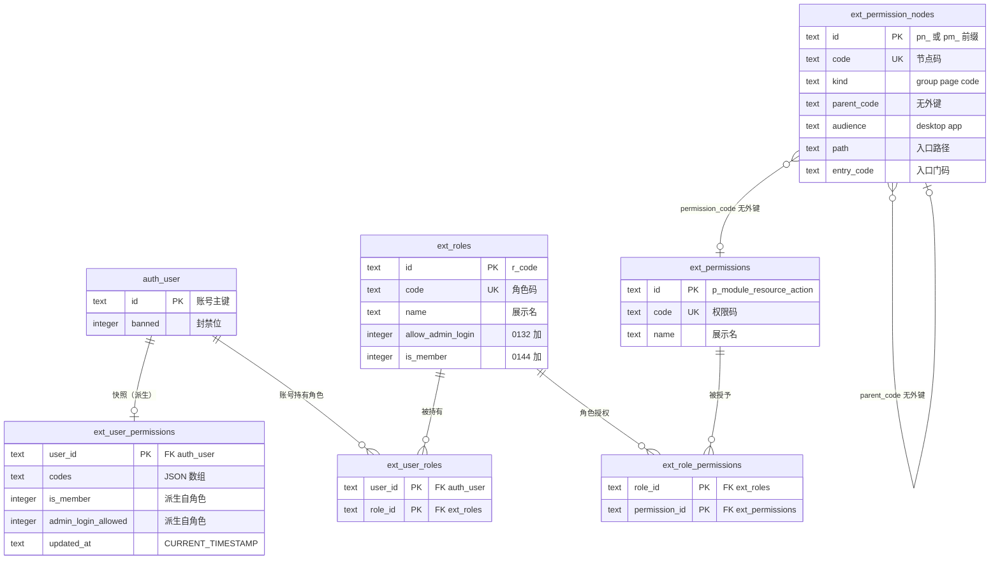

# 14 授权数据模型

> **用途**：回答「这个账号为什么有这个权限码」「我要改权限该动哪张表、还有哪些位置要同步」「哪张表是真源、哪张是派生物」「生成器怎么用」。
> **触发词**：授权模型、权限从哪来、ext_roles、ext_permissions、ext_role_permissions、ext_user_roles、ext_user_permissions、权限快照、权限树、ext_permission_nodes、角色授权、账号授权、级联、外键、快照重算、permissionId、roleId、授权数据流、权限码生成器、rbac:gen、rbac:check、rbac-catalog、seed.ts 标记区、CATALOG_NOTES、RbacPermissionDocs、权限优化。
> **加载时机**：改角色/授权关系、排查「快照与真源不一致」、给权限域加表或加列、要用生成器加码、或要理解五张表为什么要分开时读本册。**「新页面要不要加码」的判定在 09 册 §3**，不在本册。
> **单一数据源**：字段级逐列中文说明见 12 册（`12-user-system-schema.md`）§5.1；请求链路与关卡见 13 册。本册只讲**表间关系、读写点与不变量**，不复制字段说明。

## 一句话结论

**六张表分三层，只有一层是权威**：

| 层 | 表 | 性质 | 运行时是否被读 |
| --- | --- | --- | --- |
| 目录层 | `ext_roles`、`ext_permissions` | 名单：有哪些角色、有哪些权限码 | 否（鉴权不读） |
| 关联层（**真源**） | `ext_user_roles`、`ext_role_permissions` | 谁持有什么 | 否（鉴权不读） |
| 物化层（**派生**） | `ext_user_permissions` | 把上面两层 JOIN 的结果按账号压成一行 | **是，唯一被读的** |
| 视图层（旁支） | `ext_permission_nodes` | 权限码的组织结构，供侧栏与角色编辑器渲染 | 是（但只影响「看不看得到」，不授予能力） |

`ext_permission_nodes` 是**旁支**不是主线：它不参与「账号是否有某个码」的判定，只决定侧栏显示什么、角色编辑器怎么分组。这是最容易读错的一处——它名字里也有「权限」，但和授权判定无关。

## 表间关系



**两条链互不相交**：

- **授权链（决定「能做什么」）**：`ext_user_roles` → `ext_role_permissions` → `ext_permissions.code` → 聚合成 `ext_user_permissions.codes`。
- **呈现链（决定「看得到什么」）**：`ext_permission_nodes` → 侧栏行集 → 每行的 `entry_code` 与账号的 `codes` 比对。

一个页面能不能打开，判的是授权链（页面自己调 `requirePagePermission`）；一个页面在侧栏显不显示，判的是呈现链（节点的 `entry_code`）。两者用同一个码，由 `tests/unit/admin-page-guards.test.ts` 与 `tests/worker/admin-menu.test.ts` 保证相等——但它们是**两条独立的判定**，不是一次判定。

## 主键可推导，不是随机值

三个 id 都不靠自增生成，而是从 code 推导，所以「码」本身就是身份：

```ts
// src/server/rbac/seed.ts:224-230
export function permissionId(code: string): string { return `p_${code.replace(/:/g, "_")}`; }
export function roleId(code: string): string { return `r_${code}`; }
```

节点 id 同理：种子行 `pn_<code 冒号换下划线>`（`0127:11-13`），后台自建行 `pm_` 前缀（`PermissionTreeOps.ts:26/29`）。

**后果**：改一个权限码的 `code`，等于改它的主键，`ext_role_permissions.permission_id` 与 `ext_permission_nodes.permission_code` 全部悬空。所以「改码」不是改名，是一次迁移工程——`0067` 修过 `0057` 改名后的失效码，就是前例。

## 各表的角色与读写点

### `ext_roles` — 角色目录（`0028`）

| 列 | 说明 |
| --- | --- |
| `id` | `r_<code>`，主键 |
| `code` | 唯一，角色标识（`super_admin` / `editor` / `readonly`） |
| `name` | 展示名 |
| `allow_admin_login` | **`0132` 加**，默认 1。角色级「允许登录后台」，多角色取并集；零角色账号不受限 |
| `is_member` | **`0144` 加**，默认 0。会员角色标记，内容端点据此决定是否收录会员书 |

读写点：`src/server/admin/rbac-handlers.ts` 27 处（本文件内写点在 L646/677/711/746/807/819/870）；`seed.ts` 播种三个内置角色。

两个布尔列都在**角色**上而不是账号上，所以「某账号能不能进后台」要靠并集算——这就是快照里 `admin_login_allowed` 和 `is_member` 两个派生列存在的原因。

### `ext_permissions` — 权限码目录（`0028`）

只有 `id` / `code` / `name` 三列，65 行。

**关键事实：`rbac-handlers.ts` 里 0 处写入它。** 码目录只由 `src/server/rbac/seed.ts` 的 `RBAC_PERMISSIONS`（65 条）经迁移播种，后台界面不能增删权限码。想加一个码，走的是「改代码 + 写迁移」，不是点界面。

这是刻意的：`code` 是主键来源（见上节），允许在线造码会让主键规则失去封闭性。

### `ext_role_permissions` — 角色授权（`0028`）

`(role_id, permission_id)` 复合主键，两侧都 CASCADE。角色的「授权抽屉」。

写点集中在 `replaceRolePermissions`（`rbac-handlers.ts:205`，L275/290 是 DELETE + 批量 INSERT）、`deleteRbacRole`（L813）。口径是**整体替换**而不是增量：提交一组码，先删后插。

### `ext_user_roles` — 角色分配（`0028`）

`(user_id, role_id)` 复合主键，两侧都 CASCADE。**授权的单一真源**（`CONTEXT.md`「角色分配」词条）。

全仓只有 **1 个 insert 点**（`rbac-handlers.ts:1244`，`createAdminRbacUser` 建号时）与少数删除点（L578/582 是 `replaceUserRoles` 的删+插）。所以「谁有什么角色」这层异常干净。

注意它对 `auth_user(id)` 有 CASCADE：删账号会连带删分配，快照行也一起删（`ext_user_permissions` 同样 CASCADE 到 `auth_user`）。**删账号不需要手动清理权限数据**。

### `ext_user_permissions` — 权限快照（`0162`，派生）

`user_id` 单列主键，`codes` 存 JSON 数组，另有 `is_member` / `admin_login_allowed` / `updated_at`（TEXT）。

**它是全仓唯一的物化镜像**，也是运行时鉴权唯一读的表：

```sql
-- src/server/rbac/snapshot.ts:56-90（readSnapshotGate）
SELECT u.banned, COALESCE(sec.must_change_password,0), s.codes, s.is_member, s.admin_login_allowed
  FROM auth_user u
  LEFT JOIN ext_user_security sec ON sec.user_id = u.id
  LEFT JOIN ext_user_permissions s ON s.user_id = u.id
 WHERE u.id = ?
```

一次点查拿齐 `banned` / `must_change_password` / `codes` / `is_member` / `admin_login_allowed` 五个字段——这就是 ADR-0053 的收益（7.67 µs 对四表 JOIN 的 25.33 µs）。

**两条不变量**：

1. **无快照行 = 零权限**（不是「不限制」）。零角色账号拿不到行，鉴权返回空集合，`adminLoginAllowed` 为 false → 403。这是「零角色账号进不了空后台」的实现方式。
2. **`codes` 坏值就地抛错**（`snapshot.ts:38-47`）。这份数据只由本模块写入，读到非 JSON 数组说明上游已经出错，不带半截权限继续跑。

`0162` 明确不建任何索引：主键即查询条件，没有第二个访问路径。

**这段历史容易踩坑**：`ext_user_permissions` 这个名字在 `0045` 是「按账号权限覆盖」，`0046` 已删除；`0162` 用同名建的是**快照**，语义完全不同。恢复 0045 时期的旧快照时不要把它当快照表。

### `ext_permission_nodes` — 权限树（`0127`，旁支）

三态 `kind`，同一张表装三种东西：

| `kind` | 是什么 | 侧栏 | 角色编辑器 |
| --- | --- | --- | --- |
| `group` | 分组标题，无能力 | 无条件放行（不带门码），链接指向第一个子项 | 顶层容器，空组不渲染 |
| `page` | 后台页面入口 | `entry_code` 非空且账号持有该码才显示；`path` 是链接 | 变成可勾选组，组名去 `page_` 前缀 |
| `code` | 叶子勾选项 | **不进侧栏** | 叶子，可勾选 |

`audience` 分 `desktop` / `app` 两端；侧栏只读 `desktop`。`parent_code` 是 TEXT **没有外键**——它指向同表，但允许悬空（历史行的父节点被删后不会级联）。

`entry_code` 非空 ⇒ `path` 非空，由两个触发器兜底（`0133:54-68`），因为 SQLite 的 `ALTER TABLE ADD COLUMN` 不能带 CHECK。

`src/shared/PermissionTreeOps.ts`（1093 行）是这张表的全部编辑逻辑：`planPermissionOps`（5 种 op 全成或全拒）、`buildGrantGroupsFromNodes`（节点 → 角色编辑器的勾选组）、`buildPermissionExportSql`（导出成 data 迁移文本）、以及拖拽排序一族。

## 快照怎么被重算

这是「改一处要动几个位置」的真实清单。全部 7 个写点：

| # | 位置 | 触发场景 | 是否在 `db.batch` 内 |
| --- | --- | --- | --- |
| 1 | `rbac-handlers.ts:297` | `replaceRolePermissions` 改角色授权 | 是 |
| 2 | `rbac-handlers.ts:589` | `replaceUserRoles` 改账号角色 | 是 |
| 3 | `rbac-handlers.ts:716` | `setRbacRoleAdminLogin` 改后台准入 | 是 |
| 4 | `rbac-handlers.ts:751` | `setRbacRoleMember` 改会员标记 | 是 |
| 5 | `rbac-handlers.ts:1249` | `createAdminRbacUser` 建号 | 是 |
| 6 | `auth/bootstrap.ts:96` | 首次初始化建超管 | 是 |
| 7 | `auth/password-setup.ts:302` | 设密码时授予角色 | 是 |

7 处全部经 `db.batch` 提交，即原子。`seed.ts:267` 是唯一不在调用点直接进 batch 的（循环 `push` 后在 L270 统一批量提交），实际也是原子的。

两个构造函数的选择口径：

- `refreshUserSnapshotStatements(db, userId)` — **账号的角色变了**。先 `DELETE` 再 `INSERT…SELECT`，因为传空角色数组时聚合命中 0 行，「只删不插」才是正确结果。
- `refreshRoleMembersSnapshotStatements(db, roleId)` — **角色本身变了**（授权 / 准入 / 会员标记）。按角色反查 `ext_user_roles` 的成员，批量重算。

`snapshot.ts:10` 的注释是这一层的红线：**写入只能走这两个构造器，不要就地写 SQL**。绕过它们的后果不是性能问题，是 403 或越权。

## 加一个权限码要动几处

一个码的元信息天然散在三个位置——源头常量、SQL 种子、给人看的说明。原先全靠手抄，现在只有第一步与第三步是人的活。

**第一步（人）：在源头写一行。** 编辑 `src/shared/Constants.ts` 的 `PERMISSION_CODES`。这是唯一的手写入口，其余位置由它推导。

**第二步（机器）：跑一条命令。**

```bash
yarn rbac:gen
```

它会做两件事：

1. 按 `PERMISSION_CODES` 的顺序重铺 `seed.ts` 标记区里的 `RBAC_PERMISSIONS` 条目。**标记区是纯数据，只放条目**；区内若有注释会在重铺时丢掉，判断性说明写在区外的 `CATALOG_NOTES`，或写进 `RbacPermissionDocs.ts`（那里有码做键，重排不会让它跑位）。
2. 新码没有种子迁移时，新建一份 `NNNN_data_seed_<slug>_permission.sql`，写 `ext_permissions` 行。**默认不写节点行**：页面节点的 code 是 `page_<旧菜单 code>`，与路由没有可靠映射；老兜底 `page_unmapped` 也已由 `0129` 删除。静态信息下判不出父级就不写一条指向不存在父级的行——生成的迁移头部会写明该补什么。

**短名从标记区的旧值来，所以要跑两次。** 新码的 `name` 第一次是空的——生成器不替它编名字（短名会直接显示在角色编辑器里，机器起的名字会长久留在界面上）。第一次跑的结果是：标记区多出一行 `{code: "...", name: ""}`、**迁移不生成**，stderr 点名哪个码被跳过。人把那个空字符串填成中文短名，再跑第二次，`migrations/` 里才出现种子迁移。**别把第一次的报错当成「已经生成过了」**——此时磁盘上什么都还没加。

这一步漏掉时 `yarn rbac:check` 会拦下来。注意 `rbac:gen` 自己此时**退出码仍是 0**（它只是把该做的事说清楚，没硬失败），真正把门关住的是 `rbac:check` 的「短名为空」与「无迁移」两项——两者都在 `yarn check` 链里。

**第三步（人）：补长说明。** 在 `src/shared/RbacPermissionDocs.ts` 写清「缺了它会怎样」。这一段无法生成——生成出来只会是码的复述，失去存在价值。

写完跑 `yarn rbac:check` 复核。它只做只读比对，报四类问题：标记区与 `PERMISSION_CODES` 不同步、某个码没有任何迁移种进 `ext_permissions`、某个码的短名为空、某个码缺长说明。

**为什么 `check` 有价值。** 它的比对口径与 `tests/unit/admin-endpoint-guards.test.ts` 相同——都从磁盘迁移文件重放「当前库里有哪些码」，而不是读生成器的中间产物。所以它不会因为生成器自己一致就判通过。

**不需要手工做的事**：`ext_permissions` 的主键、节点主键都由 `permissionId()` / `roleId()` 从 code 推导；`ext_user_permissions` 快照由迁移里的写点重算，不因加码而失效（新码要生效得再挂到角色上，那是授权动作，不是加码动作）。

## 权限码生成器：`yarn rbac:gen`

上一节讲了「加一个码要动几处」，这一节讲那条命令**具体怎么用、什么时候用、什么时候别用**。脚本在 `scripts/rbac-catalog.ts`，`package.json` 里两个入口：

| 命令 | 做什么 | 会写文件吗 | 退出码 |
| --- | --- | --- | --- |
| `yarn rbac:gen` | 重铺 `seed.ts` 标记区；为缺迁移的码新建迁移 | **会** | 几乎总是 0（见下） |
| `yarn rbac:check` | 只读比对四类问题 | 不会 | 有问题则 1 |

### 什么时候跑

**加码时跑一次（通常两次）。** 判定条件很简单：`PERMISSION_CODES` 里出现了 `seed.ts` 里有 name 但 `migrations/` 里没种过的码；或者某个码在 `Constants.ts` 里但 `seed.ts` 里压根没有那一行。前者要生成迁移，后者要补条目。

**改码顺序时跑一次。** 标记区的条目顺序由 `PERMISSION_CODES` 的声明顺序决定（那是有意义的分组排列，不是字典序）。挪了源头的位置却没跑生成器，`rbac:check` 会报「seed.ts 的标记区与 PERMISSION_CODES 不同步」。

**改短名时不用跑。** `name` 是标记区里手写的值，直接改那一行即可——生成器会把现有 name 原样保留（它只按顺序重铺，不从别处重新推导名字）。

**只想确认状态时只跑 `check`。** 它不写任何文件，可以随便跑。它已进 `yarn check` 链，正常门禁会覆盖到，不需要额外记着。

**不需要在以下时机跑**：改 `RbacPermissionDocs.ts` 的长说明（生成器只读它、不改它）、改角色或授权关系（那是数据、不是目录）、部署或迁移应用（`manage deploy` 会自己跑迁移）。

### 它实际做的两件事

**一、重铺标记区。** 找到 `seed.ts` 里独占一行的 `// <rbac-gen:begin>` 与 `// <rbac-gen:end>`，把中间整段替换成按源头顺序排列的 `{code, name}` 条目，通配码 `*` 固定排最后。**区内是纯数据，不产出也不保留任何注释**——重铺时区里的注释会消失，判断性说明写在区外的 `CATALOG_NOTES`，或写进 `RbacPermissionDocs.ts`（那里以码为键，重排不会让它跑位）。

**二、为新码生成种子迁移。** 判据是「从全部迁移文件重放出来的 `ext_permissions` 里没有这个码」，编号取现有最大编号 +1，文件名 `NNNN_data_seed_<slug>_permission.sql`，正文只有一句 `INSERT OR IGNORE INTO ext_permissions`。

**它刻意不做的事**（每一条都有过代价）：

| 不做 | 原因 |
| --- | --- |
| 不写 `ext_permission_nodes` 节点行 | 节点 code 是 `page_<旧菜单 code>`，与路由无可靠映射（`page_all_items` 对 `all-items`、`page_edit_channel` 对 `channels/primary`）；`path` 多数是 `0133` 联 `ext_menu` 回填的，而该表已由 `0168` 删除。静态信息下判不出父级，就不写一条指向不存在父级的行——迁移头部会写明该补什么 |
| 不替新码编短名 | 短名直接显示在角色编辑器里，机器起的名字会长久留在界面上 |
| 不合并多份迁移 | 曾经「并入上一份生成的迁移」，但它会改写已 apply 过的 `.sql`，二次并入的 INSERT 永远不会执行，`d1_migrations` 台账也察觉不到。生成器不该读库判断某份是否已应用，所以合并没有安全形态。代价是连加三个码产生三个文件，而那正是可执行的真相 |
| 不改 `RbacPermissionDocs.ts` | 长说明要写「缺了它会怎样」，这是判断不是变换 |

### 退出码为什么几乎总是 0

`rbac:gen` 的定位是「把该做的事做完，并把没做完的说清楚」，不是门禁。缺短名时它**跳过生成迁移**、在 stderr 点名那个码，**但 `process.exitCode` 仍是 0**。所以不要用 `yarn rbac:gen` 的退出码判断状态，那是 `yarn rbac:check` 的职责。

### 两个必须知道的坑

**坑一：缺短名时要跑两次。** 第一次跑完，标记区会多出一行 `{code: "...", name: ""}`，迁移不生成。人把空字符串填成中文短名，再跑第二次才有 `.sql`。别把第一次那行「N 个码在等中文短名」的提示当成「已经生成过了」——此时 `migrations/` 里什么都还没加。

**坑二：别用 `indexOf` 找标记。** `seed.ts` 头顶的说明注释里也写着 `// <rbac-gen:begin>` 这一串。生成器与 `tests/unit/rbac-catalog-single-source.test.ts` 都改用整行锚定正则 `/^[ \t]*\/\/ <rbac-gen:begin>[ \t]*$/mu`，并且断言切出的内容非空。**这两道防线缺一不可**：少了整行锚定会切到那句说明，少了非空断言切错了也会静默通过。

### 谁在守着它

四条测试各守一条边，改生成器时至少要看一眼：

| 测试 | 守的边 |
| --- | --- |
| `tests/unit/rbac-catalog-single-source.test.ts` | `Constants.ts` ↔ `seed.ts` 的 `name`；标记区存在且闭合、区内无注释、每个码恰好一次；`CATALOG_NOTES` 非空且引用的迁移编号真实存在 |
| `tests/unit/admin-endpoint-guards.test.ts` | `PERMISSION_CODES` ↔ **迁移文件**（从磁盘 SQL 重放，等同库现状） |
| `tests/worker/rbac.test.ts` | `RBAC_PERMISSIONS` ↔ **数据库** |
| `tests/unit/shared/rbac-permission-docs.test.ts` | `RBAC_PERMISSIONS` ↔ 长说明 |

`rbac:check` 的比对口径与 `admin-endpoint-guards` 相同——都从磁盘迁移重放，而不是读生成器自己的中间产物。所以它不会因为「生成器自己一致」就判通过。

## 本次权限优化改了什么

这一轮治理的净效果：**加码从「手抄六处」压到「改一行 + 跑一条命令 + 补一段说明」**，并且把「漏做」从「上线后才发现」前移到「门禁当场拦下」。

### 存量问题（改之前）

| 问题 | 实际形态 |
| --- | --- |
| 一个码的元信息散在六处 | `Constants.ts`、`seed.ts`、`RbacPermissionDocs.ts`，再加三处各自的测试；加码全靠手抄，漏一处要等运行时或评审才发现 |
| `ext_menu` 与 `ext_permission_nodes` 双轨 | 侧栏结构一度靠 `ext_menu`，页面节点靠 `ext_permission_nodes`，两者要手工对齐 |
| 权限码守卫的端点没有机械校验 | `ADMIN_PAGE_GUARDS` ↔ `PERMISSION_CODES` 的对应关系只靠人看 |
| 加码没有统一入口 | 有人写 `INSERT` 到迁移，有人去 seed 类迁移里追加 |

### 改了什么

1. **`scripts/rbac-catalog.ts` 成为唯一生成入口**（`yarn rbac:gen` / `yarn rbac:check`）。标记区纯数据，说明移到区外，生成器不再需要「保住人手写注释」这种脆弱的推断。
2. **`ext_menu` 由 `0168` 删除。** 侧栏结构统一由 `ext_permission_nodes` 的 `kind='page'` / `kind='group'` 行表达，页面节点用 `path` + `entry_code` 描述对应哪个后台路由。双轨消失，也就没有「两边对齐」这件事了。
3. **`rbac:check` 进 `yarn check` 链。** 它从磁盘迁移重放库现状，报四类：seed 不同步、码无迁移、短名为空、缺长说明。
4. **新码默认不写节点行。** 早期版本的生成器会拼一个 `page_<路由>` 的父级，但页面节点 code 用的是 `page_<旧菜单 code>`，对不上；老兜底 `page_unmapped` 也已被 `0129` 删除。判不出父级时宁可不写，把「该补什么」写进迁移头部。
5. **补齐四条测试边**，并修掉三处会静默通过的断言（见下）。

### 修掉的「假通过」（值得单独记）

这一轮真正花时间的不是写功能，是**发现测试没在测东西**：

| 位置 | 症状 | 修法 |
| --- | --- | --- |
| 生成器与单测找标记区 | `indexOf("// <rbac-gen:begin>")` 命中的是文件头顶说明注释里的那一串，切出的「区」是一句说明 | 整行锚定正则 + 断言切出内容含 `RBAC_PERMISSIONS` |
| 单测「每个码恰好出现一次」 | 切片错了 `codes` 为空，去重检测恒为 `[]`，用例静默通过 | 加 `expect(codes.length).toBeGreaterThan(60)` |
| 单测「说明引用的迁移编号存在」 | `CATALOG_NOTES` 用**全角括号**「（0142）」，而正则只认半角 `\(`，编号集恒为空 | 正则同时接受 `[(（]…[)）]`，并断言 `numbers.size > 0` |

**通用教训**：凡「从集合里筛出不合规项再断言为空」的用例，都要先断言**集合本身非空**。否则上游切错、正则不匹配这类故障，恰好会让用例通过——而那正是它本该报警的时候。

## 什么时候**不**需要新码

这套判定（含判定表、两把锁、加码四步）的**唯一正文在 09 册 §3「新页面要不要新权限码」**，本册不复制，只留一句结论：35 个后台页面只用到 20 个码，详情页与新建页复用列表页的码是惯例——**加页面不等于加码**。

本册只补一点 09 册不涉及的：从数据模型看，**加码本身不改任何授权关系**。新码进 `ext_permissions` 后，没有任何角色持有它、也没有任何账号的快照包含它，所以上线后是「存在但无人可用」的静默状态，必须再走一次授权（给角色挂码）才会生效。这与「加页面」是两件事，别指望跑完生成器就有人能用。

## 不变量清单

改权限域任何一处之前，逐条确认：

1. **授权只认角色。** `ext_user_roles` 是单一真源；`auth_user.role` 已清空（`0163`）、停写停读（ADR-0054），不承载授权。
2. **快照是派生，不是真源。** 两侧不一致即为缺陷，权威永远在 `ext_user_roles` + `ext_role_permissions`。
3. **无快照行 = 无权限。** 任何时候看到「账号有角色但 403」，先查快照行是否存在、`codes` 是否为空。
4. **改 `code` = 改主键。** 主键由 code 推导，改码要连带迁 `ext_role_permissions.permission_id` 与 `ext_permission_nodes.permission_code`。
5. **`ext_permissions` 不接在线写。** 加码走代码 + 迁移，不走界面（流程见下节）。
6. **节点表不授予能力。** `ext_permission_nodes` 只决定可见性与分组；把它当授权来源会做出「看得到但打不开」的页面。
7. **删账号自动清权限。** 三张关系表都 CASCADE 到 `auth_user`，不需要手写清理。
8. **快照写入只走两个构造器。** 见上节。

## 常见误解

| 说法 | 实际 |
| --- | --- |
| 「六张表太散，运行时每次都要 JOIN」 | 运行时**只读一张表**（`ext_user_permissions`），一条点查。四表 JOIN 的 `resolveUserAccess` 只供测试与运维比对漂移，不要新增调用点 |
| 「`ext_user_permissions` 是缓存」 | 它**没有过期时间**，全靠 7 个写点主动重算。叫「快照」不叫「缓存」正是这个区别（`CONTEXT.md`「权限快照」） |
| 「`ext_permission_nodes` 是权限的另一份来源」 | 它不参与授权判定，只组织呈现 |
| 「`allow_admin_login` 是账号字段」 | 在**角色**上，多角色取并集；零角色账号不看这一列 |
| 「`ext_user_permissions` 一直是快照表」 | `0045` 的同名表是「权限覆盖」，`0046` 已删；`0162` 重建才是快照 |

## 相关

- 字段级逐列说明：`docs/zh/12-user-system-schema.md` §5.1
- 请求链路与关卡顺序：`docs/zh/13-request-pipeline.md`
- 快照为何存在及量化依据：`docs/novel-cms/adr/0053-permission-snapshot-table.md`
- 判定保持自研的量化否决：`docs/novel-cms/adr/0052-keep-custom-permission-engine.md`
- 权限树自持：`docs/novel-cms/adr/0038-permission-tree-self-hosted.md`；终端分区：`0039`
- 领域词汇（角色分配 / 权限快照 / 通配权限 / 权限判定）：`CONTEXT.md`
