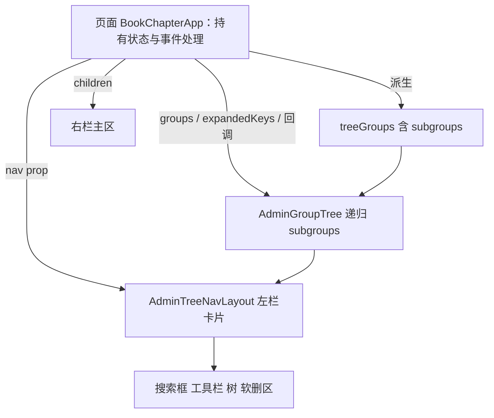

# AdminTreeNavLayout（树形导航两栏布局）

管理后台「左树形导航 + 右主区」页面的**容器壳**。它是把 `/admin/book-info/`（书本信息页）
手写的两栏骨架抽出来的结果，和 `AdminGroupTree`（分组树，见 `docs/zh/admin-group-tree.md`）
是一对：分组树管「左栏里那棵树怎么渲染」，本组件管「左栏和右栏怎么摆到一起」。

> **触发词**：两栏、布局、左树右详情、树形导航、AdminTreeNavLayout、master-detail。

## 1. 设计原则

| 原则 | 说明 |
|---|---|
| **只管呈现骨架** | 外层 flex、左栏冻结、右栏自适应——本组件只做这些，零业务分支 |
| **数据源驱动** | 左栏内容（搜索、工具栏、树、软删区）由调用方算好，整块通过 `nav` prop 传入 |
| **不认识业务** | 组件不认识「搜索」「分组」「详情」「表单」任何概念，换组、搜索过滤、选中都留在页面 |
| **与 AdminGroupTree 分工** | `AdminGroupTree` = 左栏里那棵树；本组件 = 左栏和右栏的摆放。两者嵌套使用 |
| **不重新设计** | 视觉复用既有卡片样式（`rounded-[14px] border bg-card`），与 book-info 页像素一致 |

## 2. 组件变量与 Props 契约

本组件**零内部状态、零事件回调**——它是纯函数式的呈现壳，所有动态行为都在调用方。这是它和
`AdminGroupTree`（有一组回调）最大的区别：布局壳连回调都没有，只有两个「内容槽」。

```tsx
interface AdminTreeNavLayoutProps {
  /** 左栏内容整块传入（搜索框、工具栏、分组树、软删折叠区……）。 */
  nav: ReactNode;
  /** 右栏内容（选中项详情 / 表单 / 空态引导……）。 */
  children: ReactNode;
}
```

| 变量 / prop | 作用 | 谁提供 |
|---|---|---|
| `nav` | 左栏整块内容，被包进 `<nav className="…lg:sticky…">` 卡片里 | 调用方 |
| `children` | 右栏整块内容，被包进 `<div className="min-w-0 flex-1">` 里 | 调用方 |
| 外层 `<div className="flex …lg:flex-row">` | 两栏排列：窄屏上下堆、`lg` 起左右并排 | 组件写死 |
| 左栏 `lg:sticky lg:top-4 lg:w-72 lg:overflow-y-auto` | 宽屏冻结在视口顶、固定 288px 宽、树长时栏内自滚 | 组件写死 |
| 右栏 `min-w-0 flex-1` | 占满剩余宽；`min-w-0` 防长内容把栏撑破 | 组件写死 |

没有 `sticky` 开关、没有业务 prop、没有回调——冻结在视口顶是这类页面的固定形态，写死在
组件里（需要变体时先回到契约层面讨论，不按页面名加分支）。

## 3. 数据怎么构造（调用方职责）

本组件不产数据，只摆位置。左栏那棵树的数据在**调用方**从业务数据算好，分三步
（完整版见 `docs/zh/admin-group-tree.md` §3）：

1. **原始看板** → 页面从 ajax 拿到 `{groups, statuses, books}`（`groups` = 分组清单、
   `books` = 书列表，每本带 `caseDivision` = 所属分组 key、`bookName`、`author`、`isDeleted`）。
2. **拆存活 / 软删** → `liveBooks = books.filter(b => !b.isDeleted)`、
   `deletedBooks = books.filter(b => b.isDeleted)`。树只导航存活书，软删的另收折叠区。
3. **映射成 `AdminTreeGroup[]`** → 每个分组算出「计数徽章 + 可见叶子」，两者**同口径**——都来自
   过滤后的 `visible`，所以徽章数永远等于该组实际显示的叶子数。叶子两栏：`label` = 书名、
   `description` = 作者（无作者不传 → 第二栏留空）。搜索态只留命中书、且零命中分组整组不传
   （组件不渲染没传入的组）。

```tsx
const treeGroups = useMemo(
  () => groups.map((group) => {
    const members = booksOf(group.key);                    // 该组全量存活书
    const visible = searchActive
      ? members.filter((book) => /* 书名/编号/作者命中 */)
      : members;                                            // 过滤后的可见集：喂 count 徽章 + leaves
    return {
      count: visible.length,                               // 徽章：搜索态=命中数（与 leaves 一致）；非搜索态=全量
      key: group.key,
      label: group.label,
      leaves: visible.map((book) => ({
        ...(book.author ? {description: book.author} : {}),  // 无作者 → 第二栏留空
        id: book.id,
        label: book.bookName || t("bookInfo.untitled"),
      })),
    };
  }).filter((group) => !searchActive || group.leaves.length > 0),  // 搜索态丢零命中组
  [groups, booksOf, t, searchActive, searchQuery],
);
```

算好的 `treeGroups` 通过 `<AdminGroupTree groups={treeGroups} …/>` 传进左栏，左栏整块再通过
`nav` prop 传进本组件——**数据流是单向的：页面算好 → 子组件渲染，本组件只当容器。**

## 4. 它管什么 / 不管什么

| 本组件管 | 本组件不管（留在调用方） |
|---|---|
| 外层 flex：窄屏上下堆、`lg` 起左右并排 | 搜索框与过滤逻辑 |
| 左栏卡片样式 + `lg:sticky` 冻结在视口顶 | 分组树的数据整理（`AdminGroupTree` 的活） |
| 左栏 `lg` 固定宽 + 栏内自行滚动 | 工具栏按钮、软删折叠区 |
| 右栏 `min-w-0 flex-1` 占满剩余宽 | 右栏详情/表单的切换、空态引导 |
| 把 `<nav>` 与主区摆到正确位置 | 页面级弹层（挂在布局外，见 §7） |

## 5. 数据传递：单向、自上而下

```
页面 BookInfoApp（持有全部状态 + 事件处理）
  │  board / treeGroups / selectedId / expandedKey / 右栏三态 / 各事件处理函数
  │
  ├─ nav prop ──────► <AdminTreeNavLayout> 左栏卡片
  │                     ├─ 搜索框 Input（value=treeSearch, onChange=setTreeSearch）
  │                     ├─ 工具栏 Button（onClick=openStatusManager/openGroupManager/startCreate）
  │                     └─ <AdminGroupTree groups={treeGroups} …/>   ◄─ 树的数据在页面算好
  │
  └─ children ──────► <AdminTreeNavLayout> 右栏主区
                        └─ <section> 详情 / 表单（由 selectedBook/editing/creating 三态切）
```

- **下行**：页面把算好的数据（`treeGroups`、`selectedId`、`expandedKey`）经 `nav` prop 与
  `<AdminGroupTree>` 的 props 往下传；本组件和分组树都是**受控**的，只渲染传入状态。
- **上行**：子组件把用户意图经回调抛回页面（见 §6），页面改状态、重渲染——组件自己从不改状态。
- 本组件在这条链里是**透明容器**：它不拦截、不加工、不缓存任何数据，`nav` 与 `children`
  原样渲染在正确的栏位里。

## 6. 组件事件处理（全在调用方，本组件无回调）

本组件没有任何事件回调；左栏里那棵树（`AdminGroupTree`）和右栏表单的事件都由页面处理。
以书本信息页为例，页面需要接住的意图有这些：

| 用户动作 | 触发的回调 | 页面处理（改哪个状态） |
|---|---|---|
| 在搜索框输入 | `onChange` → `setTreeSearch` | 改 `treeSearch`；派生 `searchActive`/`searchQuery`；`treeGroups` 随之只留命中、零命中组隐藏；搜索态所有有命中组强制展开 |
| 点分组头 | `onToggleGroup(key)` | 手风琴单展开：`setExpandedKey(展开===key ? null : key)`。**只切展开态、不自动选中该组任何书**——自动选中会在右栏凭空打开一本用户没点过的 |
| 点树里一本书 | `onSelectLeaf(id)` | `setSelectedId(id)` + `resetDetail(false)` → 右栏进只读详情 |
| 点工具栏「新建」 | `onClick=startCreate` | `setCreating(true)+setEditing(true)`、`setSelectedId(null)`、灌默认表单（归当前展开组、状态取 sort 最小） |
| 点详情「编辑」 | `onClick=startEdit` | 把选中书灌进表单 `setEditing(true)` |
| 表单「保存」 | `onClick=save` | 校验 → POST/PUT → 回只读详情 → `load()` 刷新 |
| 「删除 / 物理删除」 | `onClick=remove/purge` | DELETE → 软删的进左栏折叠区、物理删除的彻底移除 → `load()` |

**要点**：这些处理函数**一个都不进本组件**。布局壳连「点了什么」都不知道，它只保证左栏点的东西
出现在左栏、右栏内容出现在右栏。新增交互（如右栏加个「复制」按钮）也是页面写处理函数、往
`children` 里塞，本组件不动。

## 7. 要注意的事项

1. **页面级弹层挂布局外**：与选中项无关、未选中也要能打开的弹层（如分组/状态维护），写成
   `AdminTreeNavLayout` 的**兄弟**（同一个 `<>` 片段里、布局标签之外），别塞进 `nav` 或 `children`——
   塞进去会被左栏卡片裁剪 / 随栏滚动。卷章页的正文编辑/新建 `AdminDialog` 也按此挂法（与选中卷章
   相关，但仍是页面级弹层）。`AdminDialog` 默认宽度是固定档位（`sm:max-w-lg lg:max-w-xl`）、高度上限
   用 `100vh`；需要按视口自适应时传可选 `contentClassName` 覆盖（卷章页用 `w-[min(90vw,48rem)]` +
   `100dvh`），其余 12 个弹层不传、行为不变。
2. **根节点用 `<>…</>` 片段**：布局外还有兄弟（弹层）时，页面 `return` 的根要用片段，不能用
   `<div>`（否则弹层会被套进一个多余的全宽容器）。
3. **右栏卡片样式由页面写**：本组件只给右栏 `min-w-0 flex-1` 的容器，卡片外观
   （`rounded-[14px] border bg-card p-5 shadow-xs`）由页面在 `children` 里自己写，组件不套——
   这样右栏想放非卡片内容（如一段说明）也不受约束。
4. **集合三态另套**：加载中 / 出错 / 空列表用现成的 `AdminCollectionLoading` / `AdminCollectionError`，
   在本组件之上由页面决定渲染哪态（可整页替掉两栏，也可只替右栏），本组件不参与。
5. **左栏宽度写死 288px**：`lg:w-72`。要改宽度或响应式断点，改组件（影响所有消费者），别在页面
   用外层容器去掰。
6. **`min-w-0` 别去掉**：右栏靠它防长内容（长书名、长 URL）把 flex 栏撑破，删了会在窄内容下溢出。
7. **不往组件里加业务分支**：需要新形态（左栏宽度可调、右栏拆两列、冻结可关……）时，先回到契约
   层面讨论，不按页面名做 `if`。

## 8. 新页面接入检查清单

1. **页面持有状态**：搜索词、展开键、选中 id、右栏是详情还是表单——全部 `useState` 留在页面，组件只收 `nav` / `children`。
2. **左栏整块传 `nav`**：搜索框用 `AdminTreeSearchInput`（建议首元素、带 `aria-label` 命名 `<nav>` 地标，自带清空按钮，见 §12）+ 工具栏 + `AdminGroupTree`（或其它树）+ 可选的软删/归档折叠区。
3. **右栏整块作 `children`**：空态引导 / 详情 / 表单三态由页面切；卡片样式由页面自己写。
4. **数据先算好再传**：分组、计数、成员过滤、搜索命中都在页面算成 `AdminTreeGroup[]`，别指望组件替你过滤。
5. **事件处理写页面**：`onToggleGroup` / `onSelectLeaf` / 工具栏 onClick / 表单提交全在页面，组件无回调。
6. **弹层挂布局外 + 根用片段**：见 §7 第 1、2 条。
7. **不往组件里加业务分支**：见 §7 第 7 条。

## 9. 表单卡片间距范式

右栏卡片内部（表单 / 详情）的间距**共用一套 Tailwind class**，参考源 `/admin/items/new/`，
完整规范见 `docs/zh/07-frontend-and-styles.md`「管理后台卡片间距范式」节。速查：

| 用途 | class |
|---|---|
| 卡片容器 | `rounded-[14px] border bg-card p-5 text-card-foreground shadow-xs` |
| 区块标题 | `<h2 className="text-lg font-semibold">` |
| **每个顶层字段（独立块）** | `<div className="mt-5">…字段…</div>`（每字段单独 20px 节奏，与 `/admin/items/new/` 一致） |
| 字段网格 | `<div className="mt-5 grid grid-cols-1 gap-4 md:grid-cols-2">` |
| 按钮行 | `<div className="mt-5 flex gap-2">` |
| 破坏性告警小卡 | `rounded-lg border-destructive p-4`（独立保留，不套卡片范式） |

**节奏要点**：`/admin/items/new/` 的写法是**每个字段各包一层 `<div className="mt-5">`**，而非把多个字段塞进一个
`space-y-4` 组。这样无论字段是「标签在上、控件在下」的 `AdminInput`/`AdminSelect`，还是「开关+标签横向并排」的
`AdminSwitch`，都拿到**统一、均匀**的 20px 上间距，不会因组件内部布局差异而显出节奏断层。`space-y-4` 只用于
**自包含子块内部**（如破坏性小卡里的元素、弹层里的列表行），不要拿它替代顶层字段的 `mt-5`。

**禁用**：`rounded-lg border p-4`（旧卡片）、`<h3 className="font-medium">`（标题太浅）、
`sm:grid-cols-2`（断点太早）、用 `space-y-4` 组包顶层字段（节奏与 items/new 不一致）。

## 10. 文件与提交

- 组件：`src/components/admin/shared/AdminTreeNavLayout.tsx`
- 首个消费者（§1–§9 示例出处）：`src/components/admin/book-info/BookInfoApp.tsx`
- 三层树消费者（§11 出处）：`src/components/admin/book-chapter/BookChapterApp.tsx`
- 配套分组树：`src/components/admin/shared/AdminGroupTree.tsx`（见 `docs/zh/admin-group-tree.md`）
- 分层裁决：`docs/novel-cms/adr/0063-book-chapter-three-level-tree.md`
- 引入提交：见书本信息模块 feature 分支（`AdminTreeNavLayout` 抽取）

## 11. 三层树：传构造好的 `subgroups` 参数（ADR-0063）

### 11.1 原两层方案保留

`AdminTreeNavLayout` 的契约**没有因为三层树发生任何变化**：

| 项 | 两层页（原有） | 三层页（新增） |
|---|---|---|
| props | `nav` + `children` | **同左**，一个不多 |
| `nav` 里装什么 | 搜索框 + 工具栏 + `<AdminGroupTree groups={treeGroups}/>` + 软删区 | **同左** |
| `treeGroups` 形状 | `AdminTreeGroup[]`，每个节点给 `leaves` | `AdminTreeGroup[]`，分类节点多一个 `subgroups` |
| 谁递归 | 无 | `AdminGroupTree` 按 `subgroups` 下钻 |
| 本组件做什么 | 摆两栏 | **摆两栏**，完全一样 |

`BookInfoApp` / `MingCiApp` / `ZhongYaoApp` 仍按 §3 的两层写法，一行未改；`UsersApp` 用
`AdminGroupTree` 但不用本组件，也不受影响。**三层树是「参数形状」的扩展，不是「布局壳」的扩展**：
本组件不接收 `groups` / `expandedKeys` / 任何树回调，也不认识「层」这个概念。

### 11.2 页面只传构造好的参数

「构造好的参数」指 `AdminTreeGroup[]` 及其配套受控状态（`expandedKeys` / `selectedLeafId` /
两个回调），由页面算好后经 `AdminGroupTree` 的 props 传入；本组件收的仍然是 `ReactNode`。
数据流与 §5 一致，唯一差别是 `treeGroups` 里多了 `subgroups`：



递归发生在树组件消费参数的地方；本组件在这条链里仍是**透明容器**，不拦截、不加工、不缓存。
因此三层页不需要给布局壳加任何 prop，也不需要改布局壳代码。

### 11.3 最小调用骨架

完整可复制示例（数据构造 → 树参数 → 布局壳）统一放在 `docs/zh/admin-group-tree.md` §10，
此处只给布局壳一侧，避免两份真源：

```tsx
<AdminTreeNavLayout
  nav={
    <>
      {/* 搜索框、工具栏…… */}
      <AdminGroupTree
        emptyLeafText={t("bookChapter.groupEmpty")}
        expandedKeys={expandedKeys}
        groups={treeGroups}        {/* ← 构造好的参数，含 subgroups */}
        onSelectLeaf={selectLeaf}
        onToggleGroup={toggleGroup}
        root={{label: t("bookChapter.treeRoot"), count: liveChapters.length}}
        selectedLeafId={selectedId}
      />
      {/* 软删折叠区…… */}
    </>
  }
>
  {/* 右栏：详情 / 表单 / 空态，写法与两层页完全一致 */}
</AdminTreeNavLayout>
```

### 11.4 三层时的检查清单增量

在 §8 七条之外补四条：

1. **不要给本组件加树相关 prop**：`groups` / `expandedKeys` / 回调全属于 `AdminGroupTree`，本组件
   只收 `nav` / `children`（§2 契约不变）。
2. **左栏长树不用改布局**：`lg:max-h-[calc(100svh-6rem)] lg:overflow-y-auto` 已经处理三层展开后的
   滚动，别在页面外层再套滚动容器。
3. **键前缀隔离与空态分层**属于树参数构造，见 `docs/zh/admin-group-tree.md` §10.3 / §10.5。
4. **页面级弹层仍挂布局外**（§7 第 1 条），三层树没有改变这一约束。

## 12. 左栏搜索输入框（带清空）

5 个分组树消费者（本组件的 4 个 + `UsersApp`，后者用树但不用本组件）左栏首元素都是同一个形状的
搜索框。抽成 `src/components/admin/shared/AdminTreeSearchInput.tsx`，**独立共享组件，既不属于
`AdminTreeNavLayout` 也不属于 `AdminGroupTree`**——两个契约都不变。

| 项 | 说明 |
|---|---|
| 形态 | 一个受控 `<Input>`，最右叠加 `XIcon` 幽灵按钮；仅在 `value.length > 0` 时渲染 |
| 清空 | 点按钮调 `onValueChange("")`，页面把该回调直接接到自己的搜索 state |
| 文案 | `ariaLabel` / `placeholder` 由页面用 `t(...)` 给；清空按钮的无障碍名走通用 `common.clearSearch` |
| 不做什么 | 不持有值、不认识「搜索 / 分组 / 树」、不参与过滤；过滤口径与展开规则仍留在页面（`docs/zh/admin-group-tree.md` §1） |

调用（5 个页面各一处，裸 `<Input>` 不再出现在左栏首元素）：

```tsx
<AdminTreeSearchInput
  ariaLabel={t("bookChapter.searchAria")}
  onValueChange={setTreeSearch}
  placeholder={t("bookChapter.searchPlaceholder")}
  value={treeSearch}
/>
```

清空按钮的视觉沿用 `AdminSelect` 的 `ComboboxClear`：幽灵图标按钮、hover 转 destructive、只在有内容
时出现。输入框固定 `pr-9` 给按钮留位，有值/无值切换时文字不会跳动。
